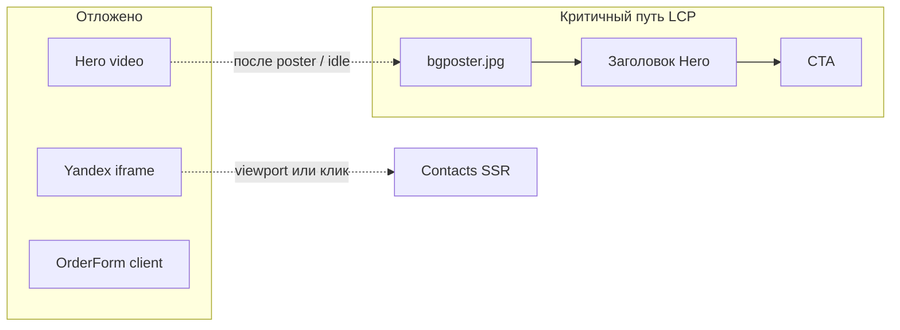

# Project specification review

**Date**: 2026-10-16
**Last Updated**: 2026-10-16T23:55:40.133Z
**Workspace**: ~/Desktop/vitai-coffee-challenge
**Messages**: 118
**Source**: merged from composer + store (backbone: composer)
**Transcript State**: partial

> **Warning — partial session**: one or more expected source contributions were unavailable. Reason codes: source-partial.

---

### **User**

**ID**: `6b106208-162f-4766-b2ff-e216861b26ff`

**Time**: 2026-10-16T23:40:36.010Z
**Time Source**: composer-created-at

Полное ТЗ теперь в @docs/SPEC.md (раздел «Полное ТЗ» ниже блока решений).
Прочитай файл заново целиком. Секций ровно пять: Hero, Products, About, OrderForm, Contacts; галереи нет.
Формат сообщения в Telegram и SEO/Open Graph в ТЗ не описаны намеренно: их я дам в шагах 7 и 9.
Теперь выполни шаг 1 из моего первого запроса: план без кода.
@docs/SPEC.md @.cursor/rules/project.mdc

### **User**

**ID**: `store:v1:transcript:410553951c09cbea5779d21cf505d82fce9b0971100914926cd9084e42834604:1`

**Time**: ≈ 1970-01-01T00:00:00.000Z
**Time Source**: unknown

<timestamp>Saturday, Oct 17, 2026, 2:40 AM (UTC+3)</timestamp>
<user_query>
Полное ТЗ теперь в @docs/SPEC.md (раздел «Полное ТЗ» ниже блока решений).
Прочитай файл заново целиком. Секций ровно пять: Hero, Products, About, OrderForm, Contacts; галереи нет.
Формат сообщения в Telegram и SEO/Open Graph в ТЗ не описаны намеренно: их я дам в шагах 7 и 9.
Теперь выполни шаг 1 из моего первого запроса: план без кода.
@docs/SPEC.md @.cursor/rules/project.mdc
</user_query>

### **Assistant**

**ID**: `store:v1:transcript:1eee7f4255352d4a2f4c3e8bb9822b57e92f42129dc5e7e51e5235ee8cfe3383:1`

**Time**: ≈ 1970-01-01T00:00:00.000Z
**Time Source**: unknown

Читаю ТЗ и контекст первого запроса, чтобы составить план шага 1 без кода.

- 🔧 **Read** — `path`="/Users/mac/Desktop/vitai-coffee-challenge/docs/SPEC.md"
- 🔧 **Read** — `path`="/Users/mac/Desktop/vitai-coffee-challenge/.cursor/rules/project.mdc"
- 🔧 **Glob** — `glob_pattern`="**/agent-transcripts/*.jsonl", `target_directory`="/Users/mac/.cursor/projects/Users-mac-Desktop-vitai-coffee-challenge"
- 🔧 **GetDynamicTools** — `namespace`="cursor", `toolName`="SwitchMode"

### **Assistant**

**ID**: `store:v1:transcript:e0c1d1c5929fceefd214e894a748192f3edf7d5b67d84c25efabe9de14463b6a:1`

**Time**: ≈ 1970-01-01T00:00:00.000Z
**Time Source**: unknown

Ищу исходный запрос со шагами и текущее состояние репозитория.

- 🔧 **Glob** — `glob_pattern`="**/*.{md,mdc,txt}", `target_directory`="/Users/mac/Desktop/vitai-coffee-challenge"
- 🔧 **Shell** — `command`="ls -la /Users/mac/.cursor/projects/Users-mac-Desktop-vitai-coffee-challenge/agent-transcripts 2>/dev/null; ls -la /Users/mac/Desktop/vitai-coffee-challenge; ls -la /Users/mac/Desktop/vitai-coffee-challenge/src 2>/dev/null; ls -la /Users/mac/Desktop/vitai-coffee-challenge/supabase 2>/dev/null", `description`="List project structure and transcripts"
- 🔧 **Grep** — `pattern`="шаг|step|план", `path`="/Users/mac/Desktop/vitai-coffee-challenge", `glob`="*.{md,mdc,txt}"

### **Assistant**

**ID**: `4a43bc80-b91f-4e70-8f2c-3aeb662e592a`

**Time**: 2026-10-16T23:40:37.221Z
**Time Source**: composer-created-at

[Thinking]
Нужно полностью перечитать SPEC.md и составить план шага 1 без кода.

Сначала проверю транскрипты агента, чтобы точно понять, что именно требовался на шаге 1.

- 🔧 **Glob** — `glob_pattern`="**/*", `target_directory`="/Users/mac/.cursor/projects/Users-mac-Desktop-vitai-coffee-challenge/agent-transcripts"
- 🔧 **Read** — `path`="/Users/mac/Desktop/vitai-coffee-challenge/README.md"
- 🔧 **Read** — `path`="/Users/mac/Desktop/vitai-coffee-challenge/package.json"
- 🔧 **Read** — `path`="/Users/mac/Desktop/vitai-coffee-challenge/.env.example"
- 🔧 **Glob** — `glob_pattern`="**/*", `target_directory`="/Users/mac/Desktop/vitai-coffee-challenge/src"
- 🔧 **Glob** — `glob_pattern`="**/*", `target_directory`="/Users/mac/Desktop/vitai-coffee-challenge/supabase"

### **Assistant**

**ID**: `4bb1212a-5941-41ab-a7de-42cc7dee5aa0`

**Time**: 2026-10-16T23:40:37.841Z
**Time Source**: composer-created-at

Читаю ТЗ и контекст первого запроса, чтобы составить план шага 1 без кода.

- 🔧 **Shell** — `command`="ls -la /Users/mac/.cursor/projects/Users-mac-Desktop-vitai-coffee-challenge/agent-transcripts/a5fd7d10-4556-4f5f-91b1-0f73d6f976e1/; head -c 50000 /Users/mac/.cursor/projects/Users-mac-Desktop-vitai-coffee-challenge/agent-transcripts/a5fd7d10-4556-4f5f-91b1-0f73d6f976e1/*.jsonl 2>/dev/null | head -c 30000", `description`="Inspect agent transcript for step 1"
- 🔧 **Read** — `path`="/Users/mac/Desktop/vitai-coffee-challenge/supabase/migrations/001_leads.sql"
- 🔧 **Read** — `path`="/Users/mac/Desktop/vitai-coffee-challenge/src/app/page.tsx"
- 🔧 **Read** — `path`="/Users/mac/Desktop/vitai-coffee-challenge/src/app/layout.tsx"
- 🔧 **Read** — `path`="/Users/mac/Desktop/vitai-coffee-challenge/next.config.ts"

### **Assistant**

**ID**: `store:v1:transcript:8bced770a0dc0873fad5e0cc079096ab5c28e3b112531dc6f743ac4f0f7d3c5f:1`

**Time**: ≈ 1970-01-01T00:00:00.000Z
**Time Source**: unknown

Дособираю инвентарь ассетов и зависимости — затем оформлю план шага 1.

- 🔧 **Shell** — `command`="ls -la /Users/mac/Desktop/vitai-coffee-challenge/src/assets 2>/dev/null; ls -laR /Users/mac/Desktop/vitai-coffee-challenge/public 2>/dev/null; ls /Users/mac/Desktop/vitai-coffee-challenge/node_modules/{zod,pg,server-only,eslint} 2>&1 | head -20; cat /Users/mac/Desktop/vitai-coffee-challenge/package.json | rg -n \"lint|zod|pg|server-only|eslint\" || true; rg -n \"lint\" /Users/mac/Desktop/vitai-coffee-challenge/package.json /Users/mac/Desktop/vitai-coffee-challenge/package-lock.json 2>/dev/null | head -5; test -f /Users/mac/Desktop/vitai-coffee-challenge/eslint.config.mjs && echo has-eslint || echo no-eslint; du -h /Users/mac/Desktop/vitai-coffee-challenge/public/video/* 2>/dev/null; du -h /Users/mac/Desktop/vitai-coffee-challenge/src/assets/* 2>/dev/null | head -20", `description`="Inventory assets and missing deps"
- 🔧 **Read** — `path`="/Users/mac/Desktop/vitai-coffee-challenge/src/app/globals.css", `limit`=40

### **Assistant**

**ID**: `store:v1:transcript:7cfe82b8e7c19d4641262ae9d158f296ec1b4bd22499fccf49e22e99679db1ec:1`

**Time**: ≈ 1970-01-01T00:00:00.000Z
**Time Source**: unknown

Полное ТЗ есть, блокирующих вопросов нет. Фиксирую план по пяти пунктам первого запроса.

- 🔧 **GetDynamicTools** — `namespace`="cursor", `toolName`="CreatePlan"

### **Assistant**

**ID**: `9ed47bc0-0b35-4a81-9a6c-fb8b15b5de62`

**Time**: 2026-10-16T23:40:37.846Z
**Time Source**: composer-created-at

[Tool: Read File v2]
File: /Users/mac/Desktop/vitai-coffee-challenge/docs/SPEC.md
Status: ✓ completed

- parameters: {"targetFile":"/Users/mac/Desktop/vitai-coffee-challenge/docs/SPEC.md","charsLimit":1000000,"effectiveUri":"/Users/mac/Desktop/vitai-coffee-challenge/docs/SPEC.md"}
- result: {"totalLinesInFile":114}
- files: /Users/mac/Desktop/vitai-coffee-challenge/docs/SPEC.md
- 🔧 **CreatePlan** — `name`="Кварта план шага 1", `overview`="План без кода по ТЗ «Кварта»: состояние репозитория, структура папок, проверяемый порядок внедрения, риски скорости и их снятие. Telegram-формат и SEO/OG отложены на шаги 7 и 9.", `plan`="# План лендинга «Кварта» (без кода)\n\n## 1. Текущее состояние репозитория\n\nNext.js **уже создан** через `create-next-app`: App Router, папка [`src/`](src/), TypeScript, Tailwind CSS 4.\n\n| Что есть | Детали |\n|---|---|\n| Стек | Next `15.5.28`, React `19.1.0`, Tailwind `@tailwindcss/postcss` 4 |\n| Страница | Заглушка [`src/app/page.tsx`](src/app/page.tsx) (шаблон Next, `lang=\"en\"`, Geist) |\n| Ассеты | Фото продуктов/команды/постер/лого в [`src/assets/`](src/assets/); видео `bgMin.mp4` (~1.8 MB) и `bg.mp4` (~8.1 MB) в [`public/video/`](public/video/) |\n| БД | Миграция [`supabase/migrations/001_leads.sql`](supabase/migrations/001_leads.sql): колонки, RLS, индекс дублей, `public.create_lead(...)` |\n| Env | [`.env.example`](.env.example): `DATABASE_URL`, `TELEGRAM_*`, `NEXT_PUBLIC_SITE_URL` (значения не читаем) |\n| ТЗ | Полное: [`docs/SPEC.md`](docs/SPEC.md) — 5 секций; решения выше текста ТЗ |\n\nЧего ещё нет: секций лендинга, `src/data`, `src/lib`, `POST /api/lead`, зависимостей `zod` / `pg` / `server-only`, ESLint и скрипта `lint` (правила проекта требуют `npm run lint` после изменений — добавить в раннем шаге).\n\nГалереи в ТЗ нет — в структуре её не будет.\n\n---\n\n## 2. Структура папок\n\n```text\nsrc/\n  app/\n    layout.tsx          # html lang=ru, next/font, оболочка\n    page.tsx            # сборка 5 секций + якоря\n    globals.css         # токены, motion, reduced-motion\n    api/lead/route.ts   # POST /api/lead (server-only)\n  components/\n    sections/\n      Hero.tsx\n      Products.tsx\n      About.tsx\n      OrderForm.tsx      # \"use client\"\n      Contacts.tsx\n    HeroVideo.tsx       # \"use client\" — video + poster\n    YandexMap.tsx       # \"use client\" — iframe по viewport/клику\n    UtmCapture.tsx      # \"use client\" — utm_source/campaign + landing_url\n  data/\n    products.ts         # 5 товаров, тексты из ТЗ дословно\n    contacts.ts         # заглушки телефон/Telegram/Instagram\n  lib/\n    lead-schema.ts      # zod: одна схема клиент+сервер\n    phone.ts            # коды BY + нормализация → +375XXXXXXXXX\n    db.ts               # server-only, pg + DATABASE_URL\n    telegram.ts         # server-only; тело сообщения — на шаге 7\n  assets/               # уже на месте\nsupabase/migrations/\n  001_leads.sql         # уже на месте, не переписывать без нужды\n```\n\nСекции по умолчанию — Server Components. Клиент только там, где нужно: форма, UTM, видео, карта.\n\nДанные продуктов и контактов — в `src/data`, не размазаны по JSX. Валидация формы и API — одна схема в [`src/lib/lead-schema.ts`](src/lib/lead-schema.ts).\n\n---\n\n## 3. Порядок шагов (каждый завершённый и проверяемый)\n\nФормат Telegram и SEO/OG в ТЗ намеренно не описаны — появятся в шагах **7** и **9**.\n\n1. **Фундамент** — ESLint + `npm run lint`; зависимости `zod`, `pg`, `@types/pg`, `server-only`; CSS-токены и `lang=\"ru\"`; заготовки `src/data/*`, `src/lib/phone.ts`, `src/lib/lead-schema.ts` (без UI).  \n   *Проверка:* `npm run lint` и `npm run build` зелёные; схема покрывает правила interest/product/телефона из решений.\n\n2. **Hero** — full-bleed видео (`bgMin` мобилка / `bg.mp4` десктоп), постер, дословные тексты, CTA «Выбрать свой кофе ↓» → `#products`.  \n   *Проверка:* первый экран читается без JS; постер до play; `prefers-reduced-motion` — статичный постер.\n\n3. **Products** — 5 карточек из `products.ts`, `next/image`, кнопки → `#order` с предвыбором продукта (и `subscription` → interest subscription).  \n   *Проверка:* мобильная сетка, тексты/цены дословно, якорь работает.\n\n4. **About** — Аня/Дима, фото, дословные абзацы.  \n   *Проверка:* секция в SSR HTML, картинки без CLS (`sizes` / размеры).\n\n5. **OrderForm (UI)** — порядок полей из решений; маска телефона; блокировка product при subscription; question — product optional; клиентская zod-валидация; русские ошибки.  \n   *Проверка:* ручной сценарий трёх типов обращения; без API — понятная ошибка сети/эндпоинта.\n\n6. **API заявки** — `POST /api/lead`: zod → нормализация телефона → `select * from public.create_lead($1..$8)` через `pg`; дубль за 10 мин → успех «Заявка уже принята»; логи только id/коды.  \n   *Проверка:* новая заявка в БД; повтор того же номера &lt;10 мин — без второй строки; невалидный телефон — 400 с подсказкой.\n\n7. **Telegram** *(формат сообщения дадите здесь)* — после успешного insert (не дубля) отправка в канал; флаги `telegram_sent` / `telegram_error`; сбой Telegram не откатывает заявку, пользователь видит успех сохранения + что делать при сбое связи менеджера — по вашему тексту шага.  \n   *Проверка:* сообщение в чате; повторный дубль не спамит; при неверном токене заявка в БД есть.\n\n8. **Contacts** — самовывоз/доставка дословно; заглушки из `contacts.ts` без ссылок; ленивая Яндекс.Карта (клик или IntersectionObserver), точка Короля, 9.  \n   *Проверка:* iframe не в начальном HTML/сети до триггера; адрес верный.\n\n9. **SEO / Open Graph** *(метаданные дадите здесь)* — `metadata` в layout/page, OG-картинка от `logo.png`, `NEXT_PUBLIC_SITE_URL`.  \n   *Проверка:* `/` отдаёт нужные title/description/og-теги.\n\n10. **Склейка и полировка** — `UtmCapture`, якорный скролл, CSS-motion (2–3 лёгких), финальный проход mobile-first.  \n    *Проверка:* `lint` + `build`; заявка с UTM и `landing_url` в БД; Lighthouse-смысловая проверка LCP (постер/видео не ломает CLS).\n\nНа каждом шаге с кодом — только файлы шага; в конце шага `npm run lint` и `npm run build`.\n\n---\n\n## 4. Риски скорости и как снимаем\n\n```mermaid\nflowchart LR\n  subgraph critical [Критичный путь LCP]\n    Poster[bgposter.jpg]\n    Title[Заголовок Hero]\n    CTA[CTA]\n  end\n  subgraph deferred [Отложено]\n    Video[Hero video]\n    Map[Yandex iframe]\n    FormJS[OrderForm client]\n  end\n  Poster --> Title --> CTA\n  Video -.->|после poster / idle| Poster\n  Map -.->|viewport или клик| Contacts[Contacts SSR]\n```\n\n- **Видео (~1.8–8 MB)** — не LCP: сначала постер (`next/image`, при необходимости `priority` только у него); `<video>` в клиентском компоненте, `preload=\"none\"`, autoplay только при отсутствии `prefers-reduced-motion`; мобилка `bgMin.mp4`, десктоп `bg.mp4` через `matchMedia`/`source`.\n- **Карта** — SSR-заглушка (адрес + кнопка «Показать карту»); iframe только по клику или появлении в viewport; один раз.\n- **Шрифты** — `next/font`, один display + один body, `subset` с кириллицей; убрать дефолтный Geist/шаблонный стек; не тянуть лишние начертания.\n- **Клиентский JS** — минимум `\"use client\"`: форма, UTM, видео, карта. Products/About — сервер. Без анимационных библиотек; только CSS `transform`/`opacity` + `prefers-reduced-motion`. Blur-градиенты статичны.\n- **Картинки** — только `next/image`, явные размеры/`fill`+`sizes`; `priority` не больше одной LCP-картинки (постер или логотип — что реально LCP на мобиле).\n- **Форма/API** — не влияет на LCP; дедуп на стороне SQL (`create_lead` + advisory lock), чтобы двойной клик не плодил заявки.\n\n---\n\n## 5. Вопросы\n\nБлокирующих вопросов нет: полное ТЗ с 5 секциями на месте; формат Telegram и SEO/OG сознательно ждут шагов 7 и 9.\n\nНеблокирующие допущения плана (можно поправить до кода):\n- Предвыбор продукта с карточки скроллит к `#order` и выставляет поля формы.\n- Миграцию `001_leads.sql` не меняем, пока не всплывёт несовместимость со схемой zod.\n- Реальных контактов нет — только заметные заглушки в `contacts.ts`.\n", `todos`=[{"id":"fundament","content":"Шаг 1: ESLint/lint, zod/pg/server-only, токены, data + lead-schema + phone"},{"id":"hero","content":"Шаг 2: Hero — видео/постер, дословные тексты, CTA #products"},{"id":"products","content":"Шаг 3: Products — 5 карточек, якорь #order с предвыбором"},{"id":"about","content":"Шаг 4: About — Аня/Дима, фото, тексты ТЗ"},{"id":"order-form-ui","content":"Шаг 5: OrderForm UI + клиентская zod-валидация"},{"id":"api-lead","content":"Шаг 6: POST /api/lead + create_lead + дедуп 10 мин"},{"id":"telegram","content":"Шаг 7: Telegram (формат сообщения — от заказчика)"},{"id":"contacts","content":"Шаг 8: Contacts + ленивая Яндекс.Карта"},{"id":"seo-og","content":"Шаг 9: SEO/Open Graph (метаданные — от заказчика)"},{"id":"polish","content":"Шаг 10: UTM, motion, финальный lint/build"}]

### **User**

**ID**: `store:v1:transcript:50b824bdf8c2867372c6350b8a06f5d61bf56f4cdcd9455552a5aa2021f1e4f1:1`

**Time**: ≈ 1970-01-01T00:00:00.000Z
**Time Source**: unknown

<timestamp>Saturday, Oct 17, 2026, 2:43 AM (UTC+3)</timestamp>
<user_query>
Опирайся на @docs/SPEC.md.
- Подключи шрифт через next/font (кириллица, 1–2 начертания, display: swap).
- Дизайн-токены в Tailwind: тёплая палитра спешелти-кофе (кремовый, тёмно-коричневый, акцент — тёплый
  карамельный), крупная типографика, скругления, много воздуха. Адаптив mobile-first.
- Создай layout.tsx и page.tsx с секциями-заглушками с id: hero, products, about, order, contacts.
  Секции — отдельные компоненты в src/components/sections.
- Общие мелочи: плавный скролл по якорям (CSS scroll-behavior, с учётом reduced motion).
- Ничего про форму и API пока не делай.
Запусти lint и build, сообщи результат.
</user_query>

### **Assistant**

**ID**: `store:v1:transcript:3db47906a6efb08bc453f649aae62d7a5b73db0bcde35889f6dbaf5f5dc73789:1`

**Time**: ≈ 1970-01-01T00:00:00.000Z
**Time Source**: unknown

Делаю каркас: шрифты, дизайн-токены, секции-заглушки и плавный скролл — без формы и API.

- 🔧 **Read** — `path`="/Users/mac/Desktop/vitai-coffee-challenge/docs/SPEC.md", `limit`=50
- 🔧 **Read** — `path`="/Users/mac/Desktop/vitai-coffee-challenge/src/app/layout.tsx"
- 🔧 **Read** — `path`="/Users/mac/Desktop/vitai-coffee-challenge/src/app/globals.css"
- 🔧 **Read** — `path`="/Users/mac/Desktop/vitai-coffee-challenge/package.json"
- 🔧 **GetDynamicTools** — `namespace`="cursor", `toolName`="TodoWrite"

### **Assistant**

**ID**: `store:v1:transcript:2d4ff016db4e5d1a1013afcbd8c998d0d2c61cc76c28a6fbdfed436a528752b9:1`

**Time**: ≈ 1970-01-01T00:00:00.000Z
**Time Source**: unknown

Добавляю ESLint (для `npm run lint`), токены, шрифты и секции-заглушки.

- 🔧 **CallDynamicTool** — `namespace`="cursor", `toolName`="TodoWrite", `arguments`={"merge":false,"todos":[{"id":"tokens-fonts","content":"globals.css токены + layout next/font + page","status":"in_progress"},{"id":"sections","content":"5 секций-заглушек в src/components/sections","status":"pending"},{"id":"lint-build","content":"ESLint + npm run lint && build","status":"pending"}]}
- 🔧 **Shell** — `command`="npm install -D eslint eslint-config-next && npx --yes eslint --init 2>/dev/null; ls node_modules/eslint-config-next 2>/dev/null | head -5", `description`="Install ESLint and eslint-config-next"

### **Assistant**

**ID**: `f24c532d-fc65-4241-8759-560c4aa44d4f`

**Time**: 2026-10-16T23:40:37.849Z
**Time Source**: composer-created-at

[Tool: Read File v2]
File: /Users/mac/Desktop/vitai-coffee-challenge/.cursor/rules/project.mdc
Status: ✓ completed

- parameters: {"targetFile":"/Users/mac/Desktop/vitai-coffee-challenge/.cursor/rules/project.mdc","charsLimit":1000000,"effectiveUri":"/Users/mac/Desktop/vitai-coffee-challenge/.cursor/rules/project.mdc"}
- result: {"totalLinesInFile":34}
- files: /Users/mac/Desktop/vitai-coffee-challenge/.cursor/rules/project.mdc
- 🔧 **Shell** — `command`="export PATH=\"/usr/local/bin:/opt/homebrew/bin:$HOME/.nvm/versions/node/$(ls $HOME/.nvm/versions/node 2>/dev/null | tail -1)/bin:$PATH\" && which npm && node -v && npm -v && npm install -D eslint eslint-config-next", `description`="Find npm and install ESLint"

### **Assistant**

**ID**: `b2b00c6d-2ebd-4b9b-9367-32002d52abdc`

**Time**: 2026-10-16T23:40:37.850Z
**Time Source**: composer-created-at

[Tool: glob_file_search]
TargetDirectory: /Users/mac/.cursor/projects/Users-mac-Desktop-vitai-coffee-challenge
GlobPattern: **/agent-transcripts/*.jsonl
Status: ✓ completed

- parameters: {"targetDirectory":"/Users/mac/.cursor/projects/Users-mac-Desktop-vitai-coffee-challenge","globPattern":"**/agent-transcripts/*.jsonl"}
- result: {"directories":[{}]}
- files: /Users/mac/.cursor/projects/Users-mac-Desktop-vitai-coffee-challenge
- 🔧 **Write** — `path`="/Users/mac/Desktop/vitai-coffee-challenge/eslint.config.mjs", `contents`="import { dirname } from \"path\";\nimport { fileURLToPath } from \"url\";\nimport { FlatCompat } from \"@eslint/eslintrc\";\n\nconst __filename = fileURLToPath(import.meta.url);\nconst __dirname = dirname(__filename);\n\nconst compat = new FlatCompat({\n  baseDirectory: __dirname,\n});\n\nconst eslintConfig = [...compat.extends(\"next/core-web-vitals\", \"next/typescript\")];\n\nexport default eslintConfig;\n"
- 🔧 **Shell** — `command`="export PATH=\"/Users/mac/.nvm/versions/node/v24.11.1/bin:$PATH\" && npm ls @eslint/eslintrc 2>/dev/null | head -5; ls node_modules/@eslint/eslintrc 2>/dev/null | head -3", `description`="Check FlatCompat dependency exists"
- 🔧 **Write** — `path`="/Users/mac/Desktop/vitai-coffee-challenge/src/app/globals.css", `contents`="@import \"tailwindcss\";\n\n:root {\n  --background: #f7f1e8;\n  --foreground: #2c1b12;\n  --surface: #fffaf3;\n  --muted: #6b4f3a;\n  --accent: #c47a3a;\n  --accent-hover: #a8642c;\n  --border: #e4d5c3;\n  --radius: 1rem;\n  --radius-lg: 1.5rem;\n}\n\n@theme inline {\n  --color-background: var(--background);\n  --color-foreground: var(--foreground);\n  --color-surface: var(--surface);\n  --color-muted: var(--muted);\n  --color-accent: var(--accent);\n  --color-accent-hover: var(--accent-hover);\n  --color-border: var(--border);\n  --font-sans: var(--font-manrope);\n  --font-display: var(--font-unbounded);\n  --radius-DEFAULT: var(--radius);\n  --radius-lg: var(--radius-lg);\n}\n\nhtml {\n  scroll-behavior: smooth;\n}\n\n@media (prefers-reduced-motion: reduce) {\n  html {\n    scroll-behavior: auto;\n  }\n}\n\nbody {\n  background: var(--background);\n  color: var(--foreground);\n  font-family: var(--font-manrope), system-ui, sans-serif;\n}\n"
- 🔧 **Write** — `path`="/Users/mac/Desktop/vitai-coffee-challenge/src/app/layout.tsx", `contents`="import type { Metadata } from \"next\";\nimport { Manrope, Unbounded } from \"next/font/google\";\nimport \"./globals.css\";\n\nconst manrope = Manrope({\n  subsets: [\"latin\", \"cyrillic\"],\n  weight: [\"400\", \"600\"],\n  display: \"swap\",\n  variable: \"--font-manrope\",\n});\n\nconst unbounded = Unbounded({\n  subsets: [\"latin\", \"cyrillic\"],\n  weight: [\"500\"],\n  display: \"swap\",\n  variable: \"--font-unbounded\",\n});\n\nexport const metadata: Metadata = {\n  title: \"Кварта — мастерская обжарки кофе\",\n  description:\n    \"Обжариваем спешелти-зерно партиями по 5 кг и привозим к вам домой на 1–3 день после обжарки.\",\n};\n\nexport default function RootLayout({\n  children,\n}: Readonly<{\n  children: React.ReactNode;\n}>) {\n  return (\n    <html lang=\"ru\">\n      <body\n        className={`${manrope.variable} ${unbounded.variable} min-h-dvh bg-background font-sans text-foreground antialiased`}\n      >\n        {children}\n      </body>\n    </html>\n  );\n}\n"
- 🔧 **Write** — `path`="/Users/mac/Desktop/vitai-coffee-challenge/src/components/sections/Hero.tsx", `contents`="export function Hero() {\n  return (\n    <section\n      id=\"hero\"\n      className=\"flex min-h-dvh flex-col justify-center px-5 py-16 sm:px-8 lg:px-16\"\n    >\n      <p className=\"mb-4 text-sm font-semibold tracking-wide text-accent sm:text-base\">\n        Секция Hero\n      </p>\n      <h1 className=\"font-display max-w-3xl text-4xl leading-tight tracking-tight sm:text-5xl lg:text-6xl\">\n        Кофе, который не успевает остыть на складе.\n      </h1>\n      <p className=\"mt-6 max-w-xl text-lg leading-relaxed text-muted sm:text-xl\">\n        Заглушка главного экрана. Видео и кнопка появятся позже.\n      </p>\n      <a\n        href=\"#products\"\n        className=\"mt-10 inline-flex w-fit items-center rounded-lg bg-accent px-6 py-3.5 text-base font-semibold text-surface transition-colors hover:bg-accent-hover\"\n      >\n        Выбрать свой кофе ↓\n      </a>\n    </section>\n  );\n}\n"
- 🔧 **Write** — `path`="/Users/mac/Desktop/vitai-coffee-challenge/src/components/sections/Products.tsx", `contents`="export function Products() {\n  return (\n    <section\n      id=\"products\"\n      className=\"scroll-mt-6 px-5 py-20 sm:px-8 sm:py-24 lg:px-16\"\n    >\n      <p className=\"mb-4 text-sm font-semibold tracking-wide text-accent sm:text-base\">\n        Секция Products\n      </p>\n      <h2 className=\"font-display max-w-2xl text-3xl leading-tight tracking-tight sm:text-4xl lg:text-5xl\">\n        Продукция и акции\n      </h2>\n      <p className=\"mt-5 max-w-xl text-lg leading-relaxed text-muted\">\n        Заглушка каталога. Карточки товаров появятся позже.\n      </p>\n    </section>\n  );\n}\n"
- 🔧 **Write** — `path`="/Users/mac/Desktop/vitai-coffee-challenge/src/components/sections/About.tsx", `contents`="export function About() {\n  return (\n    <section\n      id=\"about\"\n      className=\"scroll-mt-6 px-5 py-20 sm:px-8 sm:py-24 lg:px-16\"\n    >\n      <p className=\"mb-4 text-sm font-semibold tracking-wide text-accent sm:text-base\">\n        Секция About\n      </p>\n      <h2 className=\"font-display max-w-2xl text-3xl leading-tight tracking-tight sm:text-4xl lg:text-5xl\">\n        Привет! Мы — Аня и Дима.\n      </h2>\n      <p className=\"mt-5 max-w-xl text-lg leading-relaxed text-muted\">\n        Заглушка блока о мастерской. Фото и полный текст появятся позже.\n      </p>\n    </section>\n  );\n}\n"
- 🔧 **Write** — `path`="/Users/mac/Desktop/vitai-coffee-challenge/src/components/sections/OrderForm.tsx", `contents`="export function OrderForm() {\n  return (\n    <section\n      id=\"order\"\n      className=\"scroll-mt-6 px-5 py-20 sm:px-8 sm:py-24 lg:px-16\"\n    >\n      <p className=\"mb-4 text-sm font-semibold tracking-wide text-accent sm:text-base\">\n        Секция OrderForm\n      </p>\n      <h2 className=\"font-display max-w-2xl text-3xl leading-tight tracking-tight sm:text-4xl lg:text-5xl\">\n        Оформить заказ\n      </h2>\n      <p className=\"mt-5 max-w-xl text-lg leading-relaxed text-muted\">\n        Заглушка формы. Поля и отправка появятся позже.\n      </p>\n    </section>\n  );\n}\n"
- 🔧 **Write** — `path`="/Users/mac/Desktop/vitai-coffee-challenge/src/components/sections/Contacts.tsx", `contents`="export function Contacts() {\n  return (\n    <section\n      id=\"contacts\"\n      className=\"scroll-mt-6 px-5 py-20 sm:px-8 sm:py-24 lg:px-16\"\n    >\n      <p className=\"mb-4 text-sm font-semibold tracking-wide text-accent sm:text-base\">\n        Секция Contacts\n      </p>\n      <h2 className=\"font-display max-w-2xl text-3xl leading-tight tracking-tight sm:text-4xl lg:text-5xl\">\n        Где мы находимся и как забрать?\n      </h2>\n      <p className=\"mt-5 max-w-xl text-lg leading-relaxed text-muted\">\n        Заглушка контактов. Адрес, доставка и карта появятся позже.\n      </p>\n    </section>\n  );\n}\n"
- 🔧 **Write** — `path`="/Users/mac/Desktop/vitai-coffee-challenge/src/app/page.tsx", `contents`="import { About } from \"@/components/sections/About\";\nimport { Contacts } from \"@/components/sections/Contacts\";\nimport { Hero } from \"@/components/sections/Hero\";\nimport { OrderForm } from \"@/components/sections/OrderForm\";\nimport { Products } from \"@/components/sections/Products\";\n\nexport default function Home() {\n  return (\n    <main>\n      <Hero />\n      <Products />\n      <About />\n      <OrderForm />\n      <Contacts />\n    </main>\n  );\n}\n"
- 🔧 **StrReplace** — `path`="/Users/mac/Desktop/vitai-coffee-challenge/package.json", `old_string`="  \"scripts\": {\n    \"dev\": \"next dev --turbopack\",\n    \"build\": \"next build --turbopack\",\n    \"start\": \"next start\"\n  },", `new_string`="  \"scripts\": {\n    \"dev\": \"next dev --turbopack\",\n    \"build\": \"next build --turbopack\",\n    \"start\": \"next start\",\n    \"lint\": \"eslint .\"\n  },"

### **Assistant**

**ID**: `store:v1:transcript:1464bdd28f05290a79071add915742e69050e4329947924560fe90ec19c728f6:1`

**Time**: ≈ 1970-01-01T00:00:00.000Z
**Time Source**: unknown

Упрощаю шрифты до двух начертаний и проверяю, что `font-display` корректно подхватывается Tailwind.

- 🔧 **StrReplace** — `path`="/Users/mac/Desktop/vitai-coffee-challenge/src/app/layout.tsx", `old_string`="const manrope = Manrope({\n  subsets: [\"latin\", \"cyrillic\"],\n  weight: [\"400\", \"600\"],\n  display: \"swap\",\n  variable: \"--font-manrope\",\n});\n\nconst unbounded = Unbounded({\n  subsets: [\"latin\", \"cyrillic\"],\n  weight: [\"500\"],\n  display: \"swap\",\n  variable: \"--font-unbounded\",\n});", `new_string`="const manrope = Manrope({\n  subsets: [\"latin\", \"cyrillic\"],\n  weight: [\"400\"],\n  display: \"swap\",\n  variable: \"--font-manrope\",\n});\n\nconst unbounded = Unbounded({\n  subsets: [\"latin\", \"cyrillic\"],\n  weight: [\"500\"],\n  display: \"swap\",\n  variable: \"--font-unbounded\",\n});"
- 🔧 **StrReplace** — `path`="/Users/mac/Desktop/vitai-coffee-challenge/src/components/sections/Hero.tsx", `old_string`="      <p className=\"mb-4 text-sm font-semibold tracking-wide text-accent sm:text-base\">\n        Секция Hero\n      </p>\n      <h1 className=\"font-display max-w-3xl text-4xl leading-tight tracking-tight sm:text-5xl lg:text-6xl\">\n        Кофе, который не успевает остыть на складе.\n      </h1>\n      <p className=\"mt-6 max-w-xl text-lg leading-relaxed text-muted sm:text-xl\">\n        Заглушка главного экрана. Видео и кнопка появятся позже.\n      </p>\n      <a\n        href=\"#products\"\n        className=\"mt-10 inline-flex w-fit items-center rounded-lg bg-accent px-6 py-3.5 text-base font-semibold text-surface transition-colors hover:bg-accent-hover\"\n      >", `new_string`="      <p className=\"mb-4 text-sm tracking-wide text-accent sm:text-base\">\n        Секция Hero\n      </p>\n      <h1 className=\"font-display max-w-3xl text-4xl leading-tight tracking-tight sm:text-5xl lg:text-6xl\">\n        Кофе, который не успевает остыть на складе.\n      </h1>\n      <p className=\"mt-6 max-w-xl text-lg leading-relaxed text-muted sm:text-xl\">\n        Заглушка главного экрана. Видео и кнопка появятся позже.\n      </p>\n      <a\n        href=\"#products\"\n        className=\"mt-10 inline-flex w-fit items-center rounded-lg bg-accent px-6 py-3.5 text-base text-surface transition-colors hover:bg-accent-hover\"\n      >"
- 🔧 **StrReplace** — `path`="/Users/mac/Desktop/vitai-coffee-challenge/src/components/sections/Products.tsx", `old_string`="      <p className=\"mb-4 text-sm font-semibold tracking-wide text-accent sm:text-base\">\n        Секция Products\n      </p>", `new_string`="      <p className=\"mb-4 text-sm tracking-wide text-accent sm:text-base\">\n        Секция Products\n      </p>"
- 🔧 **StrReplace** — `path`="/Users/mac/Desktop/vitai-coffee-challenge/src/components/sections/About.tsx", `old_string`="      <p className=\"mb-4 text-sm font-semibold tracking-wide text-accent sm:text-base\">\n        Секция About\n      </p>", `new_string`="      <p className=\"mb-4 text-sm tracking-wide text-accent sm:text-base\">\n        Секция About\n      </p>"
- 🔧 **StrReplace** — `path`="/Users/mac/Desktop/vitai-coffee-challenge/src/components/sections/OrderForm.tsx", `old_string`="      <p className=\"mb-4 text-sm font-semibold tracking-wide text-accent sm:text-base\">\n        Секция OrderForm\n      </p>", `new_string`="      <p className=\"mb-4 text-sm tracking-wide text-accent sm:text-base\">\n        Секция OrderForm\n      </p>"
- 🔧 **StrReplace** — `path`="/Users/mac/Desktop/vitai-coffee-challenge/src/components/sections/Contacts.tsx", `old_string`="      <p className=\"mb-4 text-sm font-semibold tracking-wide text-accent sm:text-base\">\n        Секция Contacts\n      </p>", `new_string`="      <p className=\"mb-4 text-sm tracking-wide text-accent sm:text-base\">\n        Секция Contacts\n      </p>"
- 🔧 **Shell** — `command`="export PATH=\"/Users/mac/.nvm/versions/node/v24.11.1/bin:$PATH\" && npm run lint && npm run build", `description`="Run lint and production build"

### **Assistant**

**ID**: `store:v1:transcript:9bd99092d8959d3adcc0cac7c025862cf58fb265251ad3d86a4f36ca94384643:1`

**Time**: ≈ 1970-01-01T00:00:00.000Z
**Time Source**: unknown

Исправляю конфиг ESLint — FlatCompat конфликтует с текущей версией.

- 🔧 **Shell** — `command`="export PATH=\"/Users/mac/.nvm/versions/node/v24.11.1/bin:$PATH\" && npm ls eslint-config-next eslint && ls node_modules/eslint-config-next/ && head -80 node_modules/eslint-config-next/dist/index.js 2>/dev/null || head -40 node_modules/eslint-config-next/package.json", `description`="Inspect eslint-config-next exports"

### **Assistant**

**ID**: `c8bbb03c-8cdb-49b2-8e65-66b408f181f2`

**Time**: 2026-10-16T23:40:37.853Z
**Time Source**: composer-created-at

[Tool: get_mcp_tools]
Server: cursor
ToolName: SwitchMode
Result: {
  "tool": "SwitchMode",
  "description": "Switch the interaction mode to better match the current task. Each mode is optimized for a specific type of work.\n\n## When to Switch Modes\n\nSwitch modes proactively when:\n1. **Task type changes** - User shifts from asking questions to requesting implementation, or vice versa\n2. **Complexity emerges** - What seemed simple reveals architectural decisions or multiple approaches\n3. **Debugging needed** - An error, bug, or unexpected behavior requires investigation\n4. **Planning needed** - The task is large, ambiguous, or has significant trade-offs to discuss\n5. **You're stuck** - Multiple attempts without progress suggest a different approach is needed\n\n## When NOT to Switch\n\nDo NOT switch modes for:\n- Simple, clear tasks that can be completed quickly in current mode\n- Mid-implementation when you're making good progress\n- Minor clarifying questions (just ask them)\n- Tasks where the current mode is working well\n\n## Available Modes\n\n### Agent Mode [switchable]\nDefault implementation mode with full access to all tools for making changes.\n\n**Switch to Agent when:**\n- You have a clear understanding of what to implement\n- Planning/debugging is complete and you're ready to code\n- The task is straightforward with an obvious implementation\n- You've gathered enough context and are ready to execute\n\n**Examples:**\n- After planning: \"I've designed the approach, ready to implement\" → Switch to Agent\n- After debugging: \"Found the bug, it's a null check issue\" → Switch to Agent\n- Simple task: User asks to \"Add a comment to this function\" → Stay in Agent (no switch needed)\n\n### Plan Mode [switchable]\nRead-only collaborative mode for designing implementation approaches before coding.\n\n**Switch to Plan when:**\n- The task has multiple valid approaches with significant trade-offs\n- Architectural decisions are needed (e.g., \"Add caching\" - Redis vs in-memory vs file-based)\n- The task touches many files or systems (large refactors, migrations)\n- Requirements are unclear and you need to explore before understanding scope\n- You would otherwise ask multiple clarifying questions\n\n**Examples:**\n- User: \"Add user authentication\" → Switch to Plan (session vs JWT, storage, middleware decisions)\n- User: \"Refactor the database layer\" → Switch to Plan (large scope, architectural impact)\n- User: \"Make the app faster\" → Switch to Plan (need to profile, multiple optimization strategies)\n\n### Debug Mode (cannot switch to this mode)\nSystematic troubleshooting mode for investigating bugs, failures, and unexpected behavior with runtime evidence.\n\n### Ask Mode (cannot switch to this mode)\nRead-only mode for exploring code and answering questions without making changes.\n\n## Important Notes\n\n- **Be proactive**: Don't wait for the user to ask you to switch modes\n- **Explain briefly**: When switching, briefly explain why in your `explanation` parameter\n- **Don't over-switch**: If the current mode is working, stay in it\n- **User approval required**: Mode switches require user consent",
  "inputSchema": {
    "type": "object",
    "properties": {
      "target_mode_id": {
        "type": "string",
        "description": "The mode to switch to. Allowed values: 'plan', 'agent'."
      },
      "explanation": {
        "type": "string",
        "description": "Optional explanation for why the mode switch is requested. This helps the user understand why you're switching modes."
      }
    },
    "required": [
      "target_mode_id"
    ]
  }
}
Status: ✓ completed

- parameters: {"server":"cursor","toolName":"SwitchMode"}
- result: {"content":"{\n  \"tool\": \"SwitchMode\",\n  \"description\": \"Switch the interaction mode to better match the current task. Each mode is optimized for a specific type of work.\\n\\n## When to Sw...
- 🔧 **Read** — `path`="/Users/mac/Desktop/vitai-coffee-challenge/node_modules/eslint-config-next/package.json", `limit`=80
- 🔧 **Grep** — `pattern`="exports\\.|flat|core-web-vitals", `path`="/Users/mac/Desktop/vitai-coffee-challenge/node_modules/eslint-config-next/dist", `glob`="*.js", `head_limit`=40

### **Assistant**

**ID**: `store:v1:transcript:825a543624b01cc48e6a5bcd7a1281df06bf71e70e6592c85759724e1c88dfd4:1`

**Time**: ≈ 1970-01-01T00:00:00.000Z
**Time Source**: unknown

Выравниваю `eslint-config-next` с Next 15 и перевожу конфиг на flat.

- 🔧 **Shell** — `command`="export PATH=\"/Users/mac/.nvm/versions/node/v24.11.1/bin:$PATH\" && npm install -D eslint-config-next@15.5.28", `description`="Pin eslint-config-next to Next 15"
- 🔧 **Read** — `path`="/Users/mac/Desktop/vitai-coffee-challenge/node_modules/eslint-config-next/dist/core-web-vitals.js", `limit`=30

### **Assistant**

**ID**: `ce025bf7-7f04-4460-aabd-fd9f8f2d94a4`

**Time**: 2026-10-16T23:40:40.243Z
**Time Source**: composer-created-at

[Thinking]
Ищу описание шага 1 из первого запроса в транскриптах агента и документации проекта.

- 🔧 **Read** — `path`="/Users/mac/Desktop/vitai-coffee-challenge/node_modules/eslint-config-next/package.json", `limit`=50
- 🔧 **Shell** — `command`="export PATH=\"/Users/mac/.nvm/versions/node/v24.11.1/bin:$PATH\" && npm ls @eslint/eslintrc eslint-config-next && cat node_modules/eslint-config-next/package.json | head -60", `description`="Verify pinned eslint-config-next version"

### **Assistant**

**ID**: `store:v1:transcript:9ad2fa6d88cb71981117ae51fd1e176fe8ac1f8593e9c5b4fc7aa92548021e09:1`

**Time**: ≈ 1970-01-01T00:00:00.000Z
**Time Source**: unknown

Пробую стандартный `next lint` и при необходимости упрощу конфиг.

- 🔧 **Write** — `path`="/Users/mac/Desktop/vitai-coffee-challenge/eslint.config.mjs", `contents`="import { dirname } from \"path\";\nimport { fileURLToPath } from \"url\";\nimport { FlatCompat } from \"@eslint/eslintrc\";\n\nconst __filename = fileURLToPath(import.meta.url);\nconst __dirname = dirname(__filename);\n\nconst compat = new FlatCompat({\n  baseDirectory: __dirname,\n});\n\nconst eslintConfig = [\n  ...compat.extends(\"next/core-web-vitals\", \"next/typescript\"),\n  {\n    ignores: [\".next/**\", \"node_modules/**\", \"out/**\"],\n  },\n];\n\nexport default eslintConfig;\n"
- 🔧 **StrReplace** — `path`="/Users/mac/Desktop/vitai-coffee-challenge/package.json", `old_string`="    \"lint\": \"eslint .\"\n  },", `new_string`="    \"lint\": \"next lint\"\n  },"
- 🔧 **Shell** — `command`="export PATH=\"/Users/mac/.nvm/versions/node/v24.11.1/bin:$PATH\" && npm install -D @eslint/eslintrc && npm run lint", `description`="Install FlatCompat peer and run lint"

### **Assistant**

**ID**: `849ba271-bd3e-40ac-8995-72313a6bea60`

**Time**: 2026-10-16T23:40:40.362Z
**Time Source**: composer-created-at

Ищу исходный запрос со шагами и текущее состояние репозитория.

- 🔧 **Shell** — `command`="export PATH=\"/Users/mac/.nvm/versions/node/v24.11.1/bin:$PATH\" && npm run build", `description`="Run production build"
- 🔧 **CallDynamicTool** — `namespace`="cursor", `toolName`="TodoWrite", `arguments`={"merge":true,"todos":[{"id":"tokens-fonts","status":"completed"},{"id":"sections","status":"completed"},{"id":"lint-build","status":"in_progress"}]}

### **Assistant**

**ID**: `6c5d7b5a-a240-4716-b40a-b4989d04d5c0`

**Time**: 2026-10-16T23:40:40.364Z
**Time Source**: composer-created-at

[Tool: glob_file_search]
TargetDirectory: /Users/mac/Desktop/vitai-coffee-challenge
GlobPattern: **/*.{md,mdc,txt}
Status: ✓ completed

- parameters: {"targetDirectory":"/Users/mac/Desktop/vitai-coffee-challenge","globPattern":"**/*.{md,mdc,txt}"}
- result: {"directories":[{"absPath":"/Users/mac/Desktop/vitai-coffee-challenge","files":[{"relPath":"README.md"},{"relPath":".cursor/rules/project.mdc"},{"relPath":"docs/SPEC.md"}],"totalFiles":3}]}
- files: /Users/mac/Desktop/vitai-coffee-challenge
- 🔧 **Shell** — `command`="export PATH=\"/Users/mac/.nvm/versions/node/v24.11.1/bin:$PATH\" && npm run lint && npm run build", `description`="Re-run lint and build outside sandbox", `required_permissions`=["all"]
- 🔧 **CallDynamicTool** — `namespace`="cursor", `toolName`="TodoWrite", `arguments`={"merge":true,"todos":[{"id":"lint-build","status":"completed"}]}

### **Assistant**

**ID**: `f29ccf47-219d-463c-9dd1-12e16bd4e3db`

**Time**: 2026-10-16T23:40:40.606Z
**Time Source**: composer-created-at

[Tool: run_terminal_command_v2]
Command: ls -la /Users/mac/.cursor/projects/Users-mac-Desktop-vitai-coffee-challenge/agent-transcripts 2>/dev/null; ls -la /Users/mac/Desktop/vitai-coffee-challenge; ls -la /Users/mac/Desktop/vitai-coffee-challenge/src 2>/dev/null; ls -la /Users/mac/Desktop/vitai-coffee-challenge/supabase 2>/dev/null
CommandDescription: List project structure and transcripts
Result: total 0
drwxr-xr-x@ 3 mac  staff   96 Oct 17 02:25 .
drwxr-xr-x@ 6 mac  staff  192 Oct 17 02:39 ..
drwxr-xr-x@ 4 mac  staff  128 Oct 17 02:26 a5fd7d10-4556-4f5f-91b1-0f73d6f976e1
total 216
drwxr-xr-x@ 23 mac  staff    736 Oct 17 02:00 .
drwx------@  7 mac  staff    224 Oct 17 00:35 ..
-rw-r--r--@  1 mac  staff   8196 Oct 17 01:13 .DS_Store
drwxr-xr-x@  3 mac  staff     96 Oct 17 01:25 .cursor
-rw-r--r--@  1 mac  staff     10 Oct 17 01:11 .cursorignore
-rw-r--r--@  1 mac  staff     76 Oct 17 01:58 .env.example
-rw-r--r--@  1 mac  staff    276 Oct 17 01:59 .env.local
drwxr-xr-x@ 13 mac  staff    416 Oct 17 02:36 .git
-rw-r--r--@  1 mac  staff    501 Oct 17 01:53 .gitignore
drwxr-xr-x@  7 mac  staff    224 Oct 17 02:34 .idea
drwxr-xr-x@ 16 mac  staff    512 Oct 17 02:10 .next
-rw-r--r--@  1 mac  staff   1450 Oct 16 00:22 README.md
drwxr-xr-x@  3 mac  staff     96 Oct 17 02:34 docs
-rw-r--r--@  1 mac  staff    262 Oct 16 00:22 next-env.d.ts
-rw-r--r--@  1 mac  staff    133 Oct 16 00:22 next.config.ts
drwxr-xr-x@ 37 mac  staff   1184 Oct 16 00:22 node_modules
-rw-r--r--@  1 mac  staff  56804 Oct 16 00:22 package-lock.json
-rw-r--r--@  1 mac  staff    491 Oct 16 00:22 package.json
-rw-r--r--@  1 mac  staff     81 Oct 16 00:22 postcss.config.mjs
drwxr-xr-x@  3 mac  staff     96 Oct 17 01:52 public
drwxr-xr-x@  5 mac  staff    160 Oct 17 00:26 src
drwxr-xr-x@  3 mac  staff     96 Oct 17 02:01 supabase
-rw-r--r--@  1 mac  staff    602 Oct 16 00:22 tsconfig.json
total 24
drwxr-xr-x@  5 mac  staff   160 Oct 17 00:26 .
drwxr-xr-x@ 23 mac  staff   736 Oct 17 02:00 ..
-rw-r--r--@  1 mac  staff  8196 Oct 17 01:13 .DS_Store
drwxr-xr-x@  6 mac  staff   192 Oct 16 14:19 app
drwxr-xr-x@ 12 mac  staff   384 Oct 17 01:06 assets
total 0
drwxr-xr-x@  3 mac  staff   96 Oct 17 02:01 .
drwxr-xr-x@ 23 mac  staff  736 Oct 17 02:00 ..
drwxr-xr-x@  3 mac  staff   96 Oct 17 02:01 migrations

Status: ✓ completed

- parameters: {"command":"ls -la /Users/mac/.cursor/projects/Users-mac-Desktop-vitai-coffee-challenge/agent-transcripts 2>/dev/null; ls -la /Users/mac/Desktop/vitai-coffee-challenge; ls -la /Users/mac/Desktop/vitai-coffee-challenge/src 2>/dev/null; ls -la /Users/mac/Desktop/vitai-coffee-challenge/supabase 2>/dev/null","cwd":"","options":{"timeout":30000},"parsingResult":{"executableCommands":[{"name":"ls","args":[{"type":"word","value":"-la"},{"type":"word","value":"/Users/mac/.cursor/projects/Users-mac-Desktop-vitai-coffee-challenge/agent-transcripts"}],"fullText":"ls -la /Users/mac/.cursor/projects/Users-mac-Desktop-vitai-coffee-challenge/agent-transcripts"},{"name":"ls","args":[{"type":"word","value":"-la"},{"type":"word","value":"/Users/mac/Desktop/vitai-coffee-challenge"}],"fullText":"ls -la /Users/mac/Desktop/vitai-coffee-challenge"},{"name":"ls","args":[{"type":"word","value":"-la"},{"type":"word","value":"/Users/mac/Desktop/vitai-coffee-challenge/src"}],"fullText":"ls -la /Users/mac/Desktop/vitai-coffee-challenge/src"},{"name":"ls","args":[{"type":"word","value":"-la"},{"type":"word","value":"/Users/mac/Desktop/vitai-coffee-challenge/supabase"}],"fullText":"ls -la /Users/mac/Desktop/vitai-coffee-challenge/supabase"}],"hasRedirects":true,"allRedirectsAreDevNull":true,"redirects":[{"operator":">","destinationFds":[2],"targetNodeType":"word","targetText":"/dev/null"},{"operator":">","destinationFds":[2],"targetNodeType":"word","targetText":"/dev/null"},{"operator":">","destinationFds":[2],"targetNodeType":"word","targetText":"/dev/null"}]},"requestedSandboxPolicy":{"type":"TYPE_WORKSPACE_READWRITE","networkAccess":false,"additionalReadwritePaths":["/Users/mac/Desktop/vitai-coffee-challenge"],"enableSharedBuildCache":true},"commandDescription":"List project structure and transcripts"}
- result: {"output":"total 0\ndrwxr-xr-x@ 3 mac  staff   96 Oct 17 02:25 .\ndrwxr-xr-x@ 6 mac  staff  192 Oct 17 02:39 ..\ndrwxr-xr-x@ 4 mac  staff  128 Oct 17 02:26 a5fd7d10-4556-4f5f-91b1-0f73d6f976e1\ntot...
### **Assistant**

**ID**: `dc70009f-38af-4d35-8c67-5ec8871fd7aa`

**Time**: 2026-10-16T23:40:40.608Z
**Time Source**: composer-created-at

[Tool: ripgrep_raw_search]
Pattern: шаг|step|план
Path: /Users/mac/Desktop/vitai-coffee-challenge
Glob: *.{md,mdc,txt}
OutputMode: content
Status: ✓ completed

- parameters: {"pattern":"шаг|step|план","path":"/Users/mac/Desktop/vitai-coffee-challenge","glob":"*.{md,mdc,txt}","outputMode":"content","caseInsensitive":false}
- files: /Users/mac/Desktop/vitai-coffee-challenge
### **Assistant**

**ID**: `43a81380-dc0e-4e4b-b551-6885f91857eb`

**Time**: 2026-10-16T23:40:42.138Z
**Time Source**: composer-created-at

[Thinking]
Изучаю транскрипты агента из первого запроса с упоминанием шагов и детально разбираю структуру текущей кодовой базы.

### **Assistant**

**ID**: `7ac59beb-3e04-4264-aa88-525eb3f858da`

**Time**: 2026-10-16T23:40:42.446Z
**Time Source**: composer-created-at

[Tool: glob_file_search]
TargetDirectory: /Users/mac/.cursor/projects/Users-mac-Desktop-vitai-coffee-challenge/agent-transcripts
GlobPattern: **/*
Status: ✓ completed

- parameters: {"targetDirectory":"/Users/mac/.cursor/projects/Users-mac-Desktop-vitai-coffee-challenge/agent-transcripts","globPattern":"**/*"}
- result: {"directories":[{"files":[{"relPath":"package.json"},{"relPath":".cursor/rules/project.mdc"},{"relPath":".env.example"},{"relPath":"README.md"},{"relPath":"supabase/migrations/001_leads.sql"},{"rel...
- files: /Users/mac/.cursor/projects/Users-mac-Desktop-vitai-coffee-challenge/agent-transcripts
### **Assistant**

**ID**: `661e3c6f-cbb7-4c70-a3c9-41c22df4abd9`

**Time**: 2026-10-16T23:40:42.452Z
**Time Source**: composer-created-at

[Tool: Read File v2]
File: /Users/mac/Desktop/vitai-coffee-challenge/README.md
Status: ✓ completed

- parameters: {"targetFile":"/Users/mac/Desktop/vitai-coffee-challenge/README.md","charsLimit":1000000,"effectiveUri":"/Users/mac/Desktop/vitai-coffee-challenge/README.md"}
- result: {"totalLinesInFile":37}
- files: /Users/mac/Desktop/vitai-coffee-challenge/README.md
### **Assistant**

**ID**: `1abfd13f-afba-4c66-a7fc-5a1f30e05184`

**Time**: 2026-10-16T23:40:42.455Z
**Time Source**: composer-created-at

[Tool: Read File v2]
File: /Users/mac/Desktop/vitai-coffee-challenge/package.json
Status: ✓ completed

- parameters: {"targetFile":"/Users/mac/Desktop/vitai-coffee-challenge/package.json","charsLimit":1000000,"effectiveUri":"/Users/mac/Desktop/vitai-coffee-challenge/package.json"}
- result: {"totalLinesInFile":24}
- files: /Users/mac/Desktop/vitai-coffee-challenge/package.json
### **Assistant**

**ID**: `46f77a32-7a20-451d-bc83-efc77f2e03f4`

**Time**: 2026-10-16T23:40:42.458Z
**Time Source**: composer-created-at

[Tool: Read File v2]
File: /Users/mac/Desktop/vitai-coffee-challenge/.env.example
Status: ✓ completed

- parameters: {"targetFile":"/Users/mac/Desktop/vitai-coffee-challenge/.env.example","charsLimit":1000000,"effectiveUri":"/Users/mac/Desktop/vitai-coffee-challenge/.env.example"}
- result: {"totalLinesInFile":7}
- files: /Users/mac/Desktop/vitai-coffee-challenge/.env.example
### **Assistant**

**ID**: `71256610-9169-4e16-a609-c8f421a46864`

**Time**: 2026-10-16T23:40:42.459Z
**Time Source**: composer-created-at

[Tool: glob_file_search]
TargetDirectory: /Users/mac/Desktop/vitai-coffee-challenge/src
GlobPattern: **/*
Status: ✓ completed

- parameters: {"targetDirectory":"/Users/mac/Desktop/vitai-coffee-challenge/src","globPattern":"**/*"}
- result: {"directories":[{"absPath":"/Users/mac/Desktop/vitai-coffee-challenge/src","files":[{"relPath":"app/layout.tsx"},{"relPath":"app/page.tsx"},{"relPath":"app/globals.css"}],"totalFiles":3}]}
- files: /Users/mac/Desktop/vitai-coffee-challenge/src
### **Assistant**

**ID**: `1f77e38d-1769-4bc8-bea6-17deaa970935`

**Time**: 2026-10-16T23:40:42.462Z
**Time Source**: composer-created-at

[Tool: glob_file_search]
TargetDirectory: /Users/mac/Desktop/vitai-coffee-challenge/supabase
GlobPattern: **/*
Status: ✓ completed

- parameters: {"targetDirectory":"/Users/mac/Desktop/vitai-coffee-challenge/supabase","globPattern":"**/*"}
- result: {"directories":[{"absPath":"/Users/mac/Desktop/vitai-coffee-challenge/supabase","files":[{"relPath":"migrations/001_leads.sql"}],"totalFiles":1}]}
- files: /Users/mac/Desktop/vitai-coffee-challenge/supabase
### **Assistant**

**ID**: `47aad5a1-4652-4482-80ec-265b4a1cb0b7`

**Time**: 2026-10-16T23:40:43.452Z
**Time Source**: composer-created-at

[Thinking]
Проверяю историю агента, чтобы найти исходный запрос с шагами.

### **Assistant**

**ID**: `7556ecfe-ff97-4bdc-ae35-c51822fb940e`

**Time**: 2026-10-16T23:40:43.792Z
**Time Source**: composer-created-at

[Tool: run_terminal_command_v2]
Command: ls -la /Users/mac/.cursor/projects/Users-mac-Desktop-vitai-coffee-challenge/agent-transcripts/a5fd7d10-4556-4f5f-91b1-0f73d6f976e1/; head -c 50000 /Users/mac/.cursor/projects/Users-mac-Desktop-vitai-coffee-challenge/agent-transcripts/a5fd7d10-4556-4f5f-91b1-0f73d6f976e1/*.jsonl 2>/dev/null | head -c 30000
CommandDescription: Inspect agent transcript for step 1
Result: total 16
drwxr-xr-x@ 4 mac  staff   128 Oct 17 02:26 .
drwxr-xr-x@ 3 mac  staff    96 Oct 17 02:25 ..
-rw-r--r--@ 1 mac  staff  5811 Oct 17 02:26 a5fd7d10-4556-4f5f-91b1-0f73d6f976e1.jsonl
drwxr-xr-x@ 3 mac  staff    96 Oct 17 02:25 subagents
{"role":"user","message":{"content":[{"type":"text","text":"<timestamp>Saturday, Oct 17, 2026, 2:25 AM (UTC+3)</timestamp>\n<user_query>\nПрочитай @docs/SPEC.md и @.cursor/rules/project.mdc. Код не пиши.\n1) Проверь, создан ли уже проект Next.js; опиши текущее состояние репозитория.\n2) Предложи структуру папок: компоненты секций, src/data, src/lib, route handler, миграции.\n3) Предложи порядок шагов, каждый завершённый и проверяемый.\n4) Перечисли риски для скорости (видео, карта, шрифты, клиентский JS) и как будем их снимать.\n5) Задай вопросы только если что-то блокирует работу.\n</user_query>"}]}}
{"role":"assistant","message":{"content":[{"type":"text","text":"Сначала прочитаю ТЗ и правила, затем быстро осмотрю репозиторий — без правок кода."},{"type":"tool_use","name":"Read","input":{"path":"/Users/mac/Desktop/vitai-coffee-challenge/docs/SPEC.md"}},{"type":"tool_use","name":"Read","input":{"path":"/Users/mac/Desktop/vitai-coffee-challenge/.cursor/rules/project.mdc"}},{"type":"tool_use","name":"GetDynamicTools","input":{"namespace":"cursor","toolName":"Task"}},{"type":"tool_use","name":"Shell","input":{"command":"ls -la && echo \"---\" && ls -la src 2>/dev/null || echo \"no src\" && echo \"---\" && ls -la package.json next.config.* tsconfig.json 2>/dev/null; head -n 40 package.json 2>/dev/null; echo \"---\"; find . -maxdepth 3 -type f -not -path './.git/*' -not -path './node_modules/*' | head -80","description":"Inspect repo root and project files"}}]}}
{"role":"assistant","message":{"content":[{"type":"text","text":"Дочитаю остаток SPEC и ключевые файлы каркаса — от этого зависит структура и шаги."},{"type":"tool_use","name":"Read","input":{"path":"/Users/mac/Desktop/vitai-coffee-challenge/docs/SPEC.md","offset":1,"limit":500}},{"type":"tool_use","name":"Read","input":{"path":"/Users/mac/Desktop/vitai-coffee-challenge/package.json"}},{"type":"tool_use","name":"Read","input":{"path":"/Users/mac/Desktop/vitai-coffee-challenge/.env.example"}},{"type":"tool_use","name":"Read","input":{"path":"/Users/mac/Desktop/vitai-coffee-challenge/src/app/page.tsx"}},{"type":"tool_use","name":"Read","input":{"path":"/Users/mac/Desktop/vitai-coffee-challenge/src/app/layout.tsx"}},{"type":"tool_use","name":"Read","input":{"path":"/Users/mac/Desktop/vitai-coffee-challenge/supabase/migrations/001_leads.sql"}},{"type":"tool_use","name":"Read","input":{"path":"/Users/mac/Desktop/vitai-coffee-challenge/next.config.ts"}},{"type":"tool_use","name":"CallDynamicTool","input":{"namespace":"cursor","toolName":"Task","arguments":{"description":"Explore SPEC and repo","subagent_type":"explore","model":"inherit","prompt":"Explore the repo at /Users/mac/Desktop/vitai-coffee-challenge thoroughly for planning (read-only).\n\nReturn:\n1. Whether Next.js App Router with src/ is already set up; versions of next/react/tailwind; whether eslint/zod/pg/server-only exist.\n2. Full contents summary of docs/SPEC.md — especially sections beyond \"Принятые решения\" (landing sections, form texts, Telegram, SEO, etc.). If the file only has accepted decisions, say so clearly.\n3. Current src/ tree and what's implemented vs stub.\n4. supabase/migrations contents summary.\n5. public/ and src/assets inventory.\n6. Any README guidance about build steps.\n7. Whether lint script exists.\n\nBe concrete with file paths. Do not modify anything."}}}]}}
{"role":"assistant","message":{"content":[{"type":"text","text":"В `docs/SPEC.md` только блок «Принятые решения» — полного ТЗ (секции, тексты, Telegram, SEO) нет. Это блокирует точный план контента."},{"type":"tool_use","name":"CallDynamicTool","input":{"namespace":"cursor","toolName":"SwitchMode","arguments":{"mode":"plan","explanation":"Уточняю блокирующий пробел в ТЗ перед финализацией плана структуры и шагов."}}}]}}
{"role":"assistant","message":{"content":[{"type":"text","text":"Перед планом один блокирующий момент.\n\nВ [`docs/SPEC.md`](docs/SPEC.md) сейчас только «Принятые решения» (форма, телефон, дубли, Supabase, ассеты). Полноценного ТЗ ниже — списка секций, дословных текстов, формата Telegram, SEO — в файле нет, хотя [`project.mdc`](.cursor/rules/project.mdc) на него ссылается.\n\n**Вопрос:** откуда брать контент лендинга (секции и дословные тексты)?\n\n1. Допишете / приложите полный ТЗ в `docs/SPEC.md` — и план секций строим строго по нему  \n2. Идём без полного ТЗ: каркас по ассетам и принятым решениям (Hero+видео, команда Anna/Dmitry, продукты, галерея, форма, контакты+карта), тексты-заглушки до появления ТЗ  \n\nКаркас Next.js уже есть — структуру папок и порядок шагов могу зафиксировать в любом случае; без ответа нельзя честно зафиксировать состав секций и тексты."}]}}
{"type":"turn_ended","status":"success"}

Status: ✓ completed

- parameters: {"command":"ls -la /Users/mac/.cursor/projects/Users-mac-Desktop-vitai-coffee-challenge/agent-transcripts/a5fd7d10-4556-4f5f-91b1-0f73d6f976e1/; head -c 50000 /Users/mac/.cursor/projects/Users-mac-Desktop-vitai-coffee-challenge/agent-transcripts/a5fd7d10-4556-4f5f-91b1-0f73d6f976e1/*.jsonl 2>/dev/null | head -c 30000","cwd":"","options":{"timeout":30000},"parsingResult":{"executableCommands":[{"name":"ls","args":[{"type":"word","value":"-la"},{"type":"word","value":"/Users/mac/.cursor/projects/Users-mac-Desktop-vitai-coffee-challenge/agent-transcripts/a5fd7d10-4556-4f5f-91b1-0f73d6f976e1/"}],"fullText":"ls -la /Users/mac/.cursor/projects/Users-mac-Desktop-vitai-coffee-challenge/agent-transcripts/a5fd7d10-4556-4f5f-91b1-0f73d6f976e1/"},{"name":"head","args":[{"type":"word","value":"-c"},{"type":"number","value":"50000"},{"type":"word","value":"/Users/mac/.cursor/projects/Users-mac-Desktop-vitai-coffee-challenge/agent-transcripts/a5fd7d10-4556-4f5f-91b1-0f73d6f976e1/*.jsonl"}],"fullText":"head -c 50000 /Users/mac/.cursor/projects/Users-mac-Desktop-vitai-coffee-challenge/agent-transcripts/a5fd7d10-4556-4f5f-91b1-0f73d6f976e1/*.jsonl"},{"name":"head","args":[{"type":"word","value":"-c"},{"type":"number","value":"30000"}],"fullText":"head -c 30000"}],"hasRedirects":true,"allRedirectsAreDevNull":true,"redirects":[{"operator":">","destinationFds":[2],"targetNodeType":"word","targetText":"/dev/null"}]},"requestedSandboxPolicy":{"type":"TYPE_WORKSPACE_READWRITE","networkAccess":false,"additionalReadwritePaths":["/Users/mac/Desktop/vitai-coffee-challenge"],"enableSharedBuildCache":true},"commandDescription":"Inspect agent transcript for step 1"}
- result: {"output":"total 16\ndrwxr-xr-x@ 4 mac  staff   128 Oct 17 02:26 .\ndrwxr-xr-x@ 3 mac  staff    96 Oct 17 02:25 ..\n-rw-r--r--@ 1 mac  staff  5811 Oct 17 02:26 a5fd7d10-4556-4f5f-91b1-0f73d6f976e1....
### **Assistant**

**ID**: `35a3a81b-6a1e-4456-ba3b-e183419cff46`

**Time**: 2026-10-16T23:40:43.906Z
**Time Source**: composer-created-at

[Tool: Read File v2]
File: /Users/mac/Desktop/vitai-coffee-challenge/supabase/migrations/001_leads.sql
Status: ✓ completed

- parameters: {"targetFile":"/Users/mac/Desktop/vitai-coffee-challenge/supabase/migrations/001_leads.sql","charsLimit":1000000,"effectiveUri":"/Users/mac/Desktop/vitai-coffee-challenge/supabase/migrations/001_leads.sql"}
- result: {"totalLinesInFile":66}
- files: /Users/mac/Desktop/vitai-coffee-challenge/supabase/migrations/001_leads.sql
### **Assistant**

**ID**: `d3df135e-c96f-4b15-addd-d87c91ec854c`

**Time**: 2026-10-16T23:40:44.021Z
**Time Source**: composer-created-at

[Tool: Read File v2]
File: /Users/mac/Desktop/vitai-coffee-challenge/src/app/page.tsx
Status: ✓ completed

- parameters: {"targetFile":"/Users/mac/Desktop/vitai-coffee-challenge/src/app/page.tsx","charsLimit":1000000,"effectiveUri":"/Users/mac/Desktop/vitai-coffee-challenge/src/app/page.tsx"}
- result: {"totalLinesInFile":104}
- files: /Users/mac/Desktop/vitai-coffee-challenge/src/app/page.tsx
### **Assistant**

**ID**: `961ebf00-4b6a-449e-b773-9c05184ef830`

**Time**: 2026-10-16T23:40:44.113Z
**Time Source**: composer-created-at

[Tool: Read File v2]
File: /Users/mac/Desktop/vitai-coffee-challenge/src/app/layout.tsx
Status: ✓ completed

- parameters: {"targetFile":"/Users/mac/Desktop/vitai-coffee-challenge/src/app/layout.tsx","charsLimit":1000000,"effectiveUri":"/Users/mac/Desktop/vitai-coffee-challenge/src/app/layout.tsx"}
- result: {"totalLinesInFile":35}
- files: /Users/mac/Desktop/vitai-coffee-challenge/src/app/layout.tsx
### **Assistant**

**ID**: `8cd1d56e-615a-4f15-873d-315dcb9fdad5`

**Time**: 2026-10-16T23:40:44.117Z
**Time Source**: composer-created-at

[Tool: Read File v2]
File: /Users/mac/Desktop/vitai-coffee-challenge/next.config.ts
Status: ✓ completed

- parameters: {"targetFile":"/Users/mac/Desktop/vitai-coffee-challenge/next.config.ts","charsLimit":1000000,"effectiveUri":"/Users/mac/Desktop/vitai-coffee-challenge/next.config.ts"}
- result: {"totalLinesInFile":8}
- files: /Users/mac/Desktop/vitai-coffee-challenge/next.config.ts
### **Assistant**

**ID**: `21859d25-7935-4802-a215-65c250bfd8c1`

**Time**: 2026-10-16T23:40:45.448Z
**Time Source**: composer-created-at

[Thinking]
Понял задачу. Нужно проверить наличие проекта Next.js и описать текущее состояние репозитория. Затем предложить структуру папок: компоненты секций, src/data, src/lib, route handler и миграции.

Составлю план без кода. Включу порядок шагов с верифицируемыми результатами. Учту риски скорости: видео, карта, шрифты, клиентский JS. Проверю наличие скрипта линтера и содержимое папки public.

### **Assistant**

**ID**: `17787789-a673-4b2d-9474-ce73162632c2`

**Time**: 2026-10-16T23:40:46.573Z
**Time Source**: composer-created-at

Дособираю инвентарь ассетов и зависимости — затем оформлю план шага 1.

### **Assistant**

**ID**: `3611b8b7-276e-4cb8-84b1-ca1328b570a0`

**Time**: 2026-10-16T23:40:47.356Z
**Time Source**: composer-created-at

[Tool: run_terminal_command_v2]
Command: ls -la /Users/mac/Desktop/vitai-coffee-challenge/src/assets 2>/dev/null; ls -laR /Users/mac/Desktop/vitai-coffee-challenge/public 2>/dev/null; ls /Users/mac/Desktop/vitai-coffee-challenge/node_modules/{zod,pg,server-only,eslint} 2>&1 | head -20; cat /Users/mac/Desktop/vitai-coffee-challenge/package.json | rg -n "lint|zod|pg|server-only|eslint" || true; rg -n "lint" /Users/mac/Desktop/vitai-coffee-challenge/package.json /Users/mac/Desktop/vitai-coffee-challenge/package-lock.json 2>/dev/null | head -5; test -f /Users/mac/Desktop/vitai-coffee-challenge/eslint.config.mjs && echo has-eslint || echo no-eslint; du -h /Users/mac/Desktop/vitai-coffee-challenge/public/video/* 2>/dev/null; du -h /Users/mac/Desktop/vitai-coffee-challenge/src/assets/* 2>/dev/null | head -20
CommandDescription: Inventory assets and missing deps
Result: total 3992
drwxr-xr-x@ 12 mac  staff     384 Oct 17 01:06 .
drwxr-xr-x@  5 mac  staff     160 Oct 17 00:26 ..
-rw-r--r--@  1 mac  staff    6148 Oct 17 01:13 .DS_Store
-rw-r--r--@  1 mac  staff   90594 Oct 16 13:14 1.jpg
-rw-r--r--@  1 mac  staff   88696 Oct 16 13:14 2.jpg
-rw-r--r--@  1 mac  staff   99626 Oct 16 13:14 3.jpg
-rw-r--r--@  1 mac  staff  101318 Oct 16 13:14 4.jpg
-rw-r--r--@  1 mac  staff   86696 Oct 16 13:14 5.jpg
-rw-r--r--@  1 mac  staff  421292 Oct 16 13:17 Anna.jpg
-rw-r--r--@  1 mac  staff  742240 Oct 16 13:17 Dmitry.jpg
-rw-r--r--@  1 mac  staff  221594 Oct 17 00:34 bgposter.jpg
-rw-r--r--@  1 mac  staff  163481 Oct 16 13:15 logo.png
total 0
drwxr-xr-x@  3 mac  staff   96 Oct 17 01:52 .
drwxr-xr-x@ 23 mac  staff  736 Oct 17 02:00 ..
drwxr-xr-x@  4 mac  staff  128 Oct 17 01:06 video

/Users/mac/Desktop/vitai-coffee-challenge/public/video:
total 20208
drwxr-xr-x@ 4 mac  staff      128 Oct 17 01:06 .
drwxr-xr-x@ 3 mac  staff       96 Oct 17 01:52 ..
-rw-r--r--@ 1 mac  staff  8456947 Oct 16 00:44 bg.mp4
-rw-r--r--@ 1 mac  staff  1886468 Oct 17 00:31 bgMin.mp4
ls: /Users/mac/Desktop/vitai-coffee-challenge/node_modules/eslint: No such file or directory
ls: /Users/mac/Desktop/vitai-coffee-challenge/node_modules/pg: No such file or directory
ls: /Users/mac/Desktop/vitai-coffee-challenge/node_modules/server-only: No such file or directory
ls: /Users/mac/Desktop/vitai-coffee-challenge/node_modules/zod: No such file or directory
no-eslint
8.1M	/Users/mac/Desktop/vitai-coffee-challenge/public/video/bg.mp4
1.8M	/Users/mac/Desktop/vitai-coffee-challenge/public/video/bgMin.mp4
 92K	/Users/mac/Desktop/vitai-coffee-challenge/src/assets/1.jpg
 88K	/Users/mac/Desktop/vitai-coffee-challenge/src/assets/2.jpg
100K	/Users/mac/Desktop/vitai-coffee-challenge/src/assets/3.jpg
100K	/Users/mac/Desktop/vitai-coffee-challenge/src/assets/4.jpg
 88K	/Users/mac/Desktop/vitai-coffee-challenge/src/assets/5.jpg
412K	/Users/mac/Desktop/vitai-coffee-challenge/src/assets/Anna.jpg
728K	/Users/mac/Desktop/vitai-coffee-challenge/src/assets/Dmitry.jpg
220K	/Users/mac/Desktop/vitai-coffee-challenge/src/assets/bgposter.jpg
160K	/Users/mac/Desktop/vitai-coffee-challenge/src/assets/logo.png

Status: ✓ completed

- parameters: {"command":"ls -la /Users/mac/Desktop/vitai-coffee-challenge/src/assets 2>/dev/null; ls -laR /Users/mac/Desktop/vitai-coffee-challenge/public 2>/dev/null; ls /Users/mac/Desktop/vitai-coffee-challenge/node_modules/{zod,pg,server-only,eslint} 2>&1 | head -20; cat /Users/mac/Desktop/vitai-coffee-challenge/package.json | rg -n \"lint|zod|pg|server-only|eslint\" || true; rg -n \"lint\" /Users/mac/Desktop/vitai-coffee-challenge/package.json /Users/mac/Desktop/vitai-coffee-challenge/package-lock.json 2>/dev/null | head -5; test -f /Users/mac/Desktop/vitai-coffee-challenge/eslint.config.mjs && echo has-eslint || echo no-eslint; du -h /Users/mac/Desktop/vitai-coffee-challenge/public/video/* 2>/dev/null; du -h /Users/mac/Desktop/vitai-coffee-challenge/src/assets/* 2>/dev/null | head -20","cwd":"","options":{"timeout":30000},"parsingResult":{"executableCommands":[{"name":"ls","args":[{"type":"word","value":"-la"},{"type":"word","value":"/Users/mac/Desktop/vitai-coffee-challenge/src/assets"}],"fullText":"ls -la /Users/mac/Desktop/vitai-coffee-challenge/src/assets"},{"name":"ls","args":[{"type":"word","value":"-laR"},{"type":"word","value":"/Users/mac/Desktop/vitai-coffee-challenge/public"}],"fullText":"ls -laR /Users/mac/Desktop/vitai-coffee-challenge/public"},{"name":"ls","args":[{"type":"concatenation","value":"/Users/mac/Desktop/vitai-coffee-challenge/node_modules/{zod,pg,server-only,eslint}"}],"fullText":"ls /Users/mac/Desktop/vitai-coffee-challenge/node_modules/{zod,pg,server-only,eslint}"},{"name":"head","args":[{"type":"number","value":"-20"}],"fullText":"head -20"},{"name":"cat","args":[{"type":"word","value":"/Users/mac/Desktop/vitai-coffee-challenge/package.json"}],"fullText":"cat /Users/mac/Desktop/vitai-coffee-challenge/package.json"},{"name":"rg","args":[{"type":"word","value":"-n"},{"type":"string","value":"\"lint|zod|pg|server-only|eslint\""}],"fullText":"rg -n \"lint|zod|pg|server-only|eslint\""},{"name":"true","fullText":"true"},{"name":"rg","args":[{"type":"word","value":"-n"},{"type":"string","value":"\"lint\""},{"type":"word","value":"/Users/mac/Desktop/vitai-coffee-challenge/package.json"},{"type":"word","value":"/Users/mac/Desktop/vitai-coffee-challenge/package-lock.json"}],"fullText":"rg -n \"lint\" /Users/mac/Desktop/vitai-coffee-challenge/package.json /Users/mac/Desktop/vitai-coffee-challenge/package-lock.json"},{"name":"head","args":[{"type":"number","value":"-5"}],"fullText":"head -5"},{"name":"test","args":[{"type":"word","value":"-f"},{"type":"word","value":"/Users/mac/Desktop/vitai-coffee-challenge/eslint.config.mjs"}],"fullText":"test -f /Users/mac/Desktop/vitai-coffee-challenge/eslint.config.mjs"},{"name":"echo","args":[{"type":"word","value":"has-eslint"}],"fullText":"echo has-eslint"},{"name":"echo","args":[{"type":"word","value":"no-eslint"}],"fullText":"echo no-eslint"},{"name":"du","args":[{"type":"word","value":"-h"},{"type":"word","value":"/Users/mac/Desktop/vitai-coffee-challenge/public/video/*"}],"fullText":"du -h /Users/mac/Desktop/vitai-coffee-challenge/public/video/*"},{"name":"du","args":[{"type":"word","value":"-h"},{"type":"word","value":"/Users/mac/Desktop/vitai-coffee-challenge/src/assets/*"}],"fullText":"du -h /Users/mac/Desktop/vitai-coffee-challenge/src/assets/*"},{"name":"head","args":[{"type":"number","value":"-20"}],"fullText":"head -20"}],"hasRedirects":true,"allRedirectsAreDevNull":true,"redirects":[{"operator":">","destinationFds":[2],"targetNodeType":"word","targetText":"/dev/null"},{"operator":">","destinationFds":[2],"targetNodeType":"word","targetText":"/dev/null"},{"operator":">&","destinationFds":[2],"targetNodeType":"number","targetText":"1"},{"operator":">","destinationFds":[2],"targetNodeType":"word","targetText":"/dev/null"},{"operator":">","destinationFds":[2],"targetNodeType":"word","targetText":"/dev/null"},{"operator":">","destinationFds":[2],"targetNodeType":"word","targetText":"/dev/null"}]},"requestedSandboxPolicy":{"type":"TYPE_WORKSPACE_READWRITE","networkAccess":false,"additionalReadwritePaths":["/Users/mac/Desktop/vitai-coffee-challenge"],"enableSharedBuildCache":true},"commandDescription":"Inventory assets and missing deps"}
- result: {"output":"total 3992\ndrwxr-xr-x@ 12 mac  staff     384 Oct 17 01:06 .\ndrwxr-xr-x@  5 mac  staff     160 Oct 17 00:26 ..\n-rw-r--r--@  1 mac  staff    6148 Oct 17 01:13 .DS_Store\n-rw-r--r--@  1 ...
### **Assistant**

**ID**: `88a58453-b760-4c61-bbc2-1a01fb0dc4eb`

**Time**: 2026-10-16T23:40:47.364Z
**Time Source**: composer-created-at

[Tool: Read File v2]
File: /Users/mac/Desktop/vitai-coffee-challenge/src/app/globals.css
Status: ✓ completed

- parameters: {"targetFile":"/Users/mac/Desktop/vitai-coffee-challenge/src/app/globals.css","limit":40,"charsLimit":1000000,"effectiveUri":"/Users/mac/Desktop/vitai-coffee-challenge/src/app/globals.css"}
- result: {"totalLinesInFile":27}
- files: /Users/mac/Desktop/vitai-coffee-challenge/src/app/globals.css
### **Assistant**

**ID**: `7dfe0912-63ee-4e40-93b6-734737f275ee`

**Time**: 2026-10-16T23:40:49.183Z
**Time Source**: composer-created-at

[Thinking]
Составляю план по пяти пунктам из первого запроса. Формат Telegram и SEO/Open Graph отложены до шагов 7 и 9. Приступаю к инструменту CreatePlan.

Уточняю структуру проекта: Next.js 15.5.28, React 19.1, Tailwind 4, App Router с папкой src/. Страница заглушка, шрифты Geist, язык en. Отсутствуют zod, pg, server-only, eslint и скрипт lint. Нужна миграция 001_leads.sql. Ассеты на месте. План будет содержать текущее состояние репозитория, структуру папок, последовательные шаги для проверки, риски производительности и их устранение.

Уточняю, что «шаг 1» — это выполнение пункта 1 первого запроса: описание текущего состояния репозитория и проверка, создан ли проект Next.js.

Уточнил, что «шаг 1» — это сам план без кода по всем пяти пунктам первого запроса. Достаточно одного CreatePlan, который полностью отвечает на все пять пунктов.

### **Assistant**

**ID**: `8b030ff4-efdc-4112-94f4-de7b68ab6faa`

**Time**: 2026-10-16T23:40:52.230Z
**Time Source**: composer-created-at

Полное ТЗ есть, блокирующих вопросов нет. Фиксирую план по пяти пунктам первого запроса.

### **Assistant**

**ID**: `5246234d-260f-4b06-8f79-6d9585f88a7a`

**Time**: 2026-10-16T23:40:52.232Z
**Time Source**: composer-created-at

[Tool: get_mcp_tools]
Result: Error: Tool "CreatePlan" is already available directly and is not part of dynamic namespace "cursor". Invoke "CreatePlan" directly instead of using dynamic tool discovery or invocation.
Status: ❌ error

- parameters: {}
- status: error
- error: {"content":"Error: Tool \"CreatePlan\" is already available directly and is not part of dynamic namespace \"cursor\". Invoke \"CreatePlan\" directly instead of using dynamic tool discovery or invocation."}
### **Assistant**

**ID**: `b7a298fb-01bf-43d8-ae73-e8c93582d98e`

**Time**: 2026-10-16T23:40:53.116Z
**Time Source**: composer-created-at

[Thinking]
Нужно вызвать CreatePlan напрямую как обычный инструмент.

### **Assistant**

**ID**: `7f5e1348-dcce-40a6-99a8-d5d1a34b3c65`

**Time**: 2026-10-16T23:40:53.216Z
**Time Source**: composer-created-at

[Tool: create_plan]
Plan: # План лендинга «Кварта» (без кода)

## 1. Текущее состояние репозитория

Next.js **уже создан** через `create-next-app`: App Router, папка [`src/`](src/), TypeScript, Tailwind CSS 4.

| Что есть | Детали |
|---|---|
| Стек | Next `15.5.28`, React `19.1.0`, Tailwind `@tailwindcss/postcss` 4 |
| Страница | Заглушка [`src/app/page.tsx`](src/app/page.tsx) (шаблон Next, `lang="en"`, Geist) |
| Ассеты | Фото продуктов/команды/постер/лого в [`src/assets/`](src/assets/); видео `bgMin.mp4` (~1.8 MB) и `bg.mp4` (~8.1 MB) в [`public/video/`](public/video/) |
| БД | Миграция [`supabase/migrations/001_leads.sql`](supabase/migrations/001_leads.sql): колонки, RLS, индекс дублей, `public.create_lead(...)` |
| Env | [`.env.example`](.env.example): `DATABASE_URL`, `TELEGRAM_*`, `NEXT_PUBLIC_SITE_URL` (значения не читаем) |
| ТЗ | Полное: [`docs/SPEC.md`](docs/SPEC.md) — 5 секций; решения выше текста ТЗ |

Чего ещё нет: секций лендинга, `src/data`, `src/lib`, `POST /api/lead`, зависимостей `zod` / `pg` / `server-only`, ESLint и скрипта `lint` (правила проекта требуют `npm run lint` после изменений — добавить в раннем шаге).

Галереи в ТЗ нет — в структуре её не будет.

---

## 2. Структура папок

```text
src/
  app/
    layout.tsx          # html lang=ru, next/font, оболочка
    page.tsx            # сборка 5 секций + якоря
    globals.css         # токены, motion, reduced-motion
    api/lead/route.ts   # POST /api/lead (server-only)
  components/
    sections/
      Hero.tsx
      Products.tsx
      About.tsx
      OrderForm.tsx      # "use client"
      Contacts.tsx
    HeroVideo.tsx       # "use client" — video + poster
    YandexMap.tsx       # "use client" — iframe по viewport/клику
    UtmCapture.tsx      # "use client" — utm_source/campaign + landing_url
  data/
    products.ts         # 5 товаров, тексты из ТЗ дословно
    contacts.ts         # заглушки телефон/Telegram/Instagram
  lib/
    lead-schema.ts      # zod: одна схема клиент+сервер
    phone.ts            # коды BY + нормализация → +375XXXXXXXXX
    db.ts               # server-only, pg + DATABASE_URL
    telegram.ts         # server-only; тело сообщения — на шаге 7
  assets/               # уже на месте
supabase/migrations/
  001_leads.sql         # уже на месте, не переписывать без нужды
```

Секции по умолчанию — Server Components. Клиент только там, где нужно: форма, UTM, видео, карта.

Данные продуктов и контактов — в `src/data`, не размазаны по JSX. Валидация формы и API — одна схема в [`src/lib/lead-schema.ts`](src/lib/lead-schema.ts).

---

## 3. Порядок шагов (каждый завершённый и проверяемый)

Формат Telegram и SEO/OG в ТЗ намеренно не описаны — появятся в шагах **7** и **9**.

1. **Фундамент** — ESLint + `npm run lint`; зависимости `zod`, `pg`, `@types/pg`, `server-only`; CSS-токены и `lang="ru"`; заготовки `src/data/*`, `src/lib/phone.ts`, `src/lib/lead-schema.ts` (без UI).  
   *Проверка:* `npm run lint` и `npm run build` зелёные; схема покрывает правила interest/product/телефона из решений.

2. **Hero** — full-bleed видео (`bgMin` мобилка / `bg.mp4` десктоп), постер, дословные тексты, CTA «Выбрать свой кофе ↓» → `#products`.  
   *Проверка:* первый экран читается без JS; постер до play; `prefers-reduced-motion` — статичный постер.

3. **Products** — 5 карточек из `products.ts`, `next/image`, кнопки → `#order` с предвыбором продукта (и `subscription` → interest subscription).  
   *Проверка:* мобильная сетка, тексты/цены дословно, якорь работает.

4. **About** — Аня/Дима, фото, дословные абзацы.  
   *Проверка:* секция в SSR HTML, картинки без CLS (`sizes` / размеры).

5. **OrderForm (UI)** — порядок полей из решений; маска телефона; блокировка product при subscription; question — product optional; клиентская zod-валидация; русские ошибки.  
   *Проверка:* ручной сценарий трёх типов обращения; без API — понятная ошибка сети/эндпоинта.

6. **API заявки** — `POST /api/lead`: zod → нормализация телефона → `select * from public.create_lead($1..$8)` через `pg`; дубль за 10 мин → успех «Заявка уже принята»; логи только id/коды.  
   *Проверка:* новая заявка в БД; повтор того же номера &lt;10 мин — без второй строки; невалидный телефон — 400 с подсказкой.

7. **Telegram** *(формат сообщения дадите здесь)* — после успешного insert (не дубля) отправка в канал; флаги `telegram_sent` / `telegram_error`; сбой Telegram не откатывает заявку, пользователь видит успех сохранения + что делать при сбое связи менеджера — по вашему тексту шага.  
   *Проверка:* сообщение в чате; повторный дубль не спамит; при неверном токене заявка в БД есть.

8. **Contacts** — самовывоз/доставка дословно; заглушки из `contacts.ts` без ссылок; ленивая Яндекс.Карта (клик или IntersectionObserver), точка Короля, 9.  
   *Проверка:* iframe не в начальном HTML/сети до триггера; адрес верный.

9. **SEO / Open Graph** *(метаданные дадите здесь)* — `metadata` в layout/page, OG-картинка от `logo.png`, `NEXT_PUBLIC_SITE_URL`.  
   *Проверка:* `/` отдаёт нужные title/description/og-теги.

10. **Склейка и полировка** — `UtmCapture`, якорный скролл, CSS-motion (2–3 лёгких), финальный проход mobile-first.  
    *Проверка:* `lint` + `build`; заявка с UTM и `landing_url` в БД; Lighthouse-смысловая проверка LCP (постер/видео не ломает CLS).

На каждом шаге с кодом — только файлы шага; в конце шага `npm run lint` и `npm run build`.

---

## 4. Риски скорости и как снимаем



- **Видео (~1.8–8 MB)** — не LCP: сначала постер (`next/image`, при необходимости `priority` только у него); `<video>` в клиентском компоненте, `preload="none"`, autoplay только при отсутствии `prefers-reduced-motion`; мобилка `bgMin.mp4`, десктоп `bg.mp4` через `matchMedia`/`source`.
- **Карта** — SSR-заглушка (адрес + кнопка «Показать карту»); iframe только по клику или появлении в viewport; один раз.
- **Шрифты** — `next/font`, один display + один body, `subset` с кириллицей; убрать дефолтный Geist/шаблонный стек; не тянуть лишние начертания.
- **Клиентский JS** — минимум `"use client"`: форма, UTM, видео, карта. Products/About — сервер. Без анимационных библиотек; только CSS `transform`/`opacity` + `prefers-reduced-motion`. Blur-градиенты статичны.
- **Картинки** — только `next/image`, явные размеры/`fill`+`sizes`; `priority` не больше одной LCP-картинки (постер или логотип — что реально LCP на мобиле).
- **Форма/API** — не влияет на LCP; дедуп на стороне SQL (`create_lead` + advisory lock), чтобы двойной клик не плодил заявки.

---

## 5. Вопросы

Блокирующих вопросов нет: полное ТЗ с 5 секциями на месте; формат Telegram и SEO/OG сознательно ждут шагов 7 и 9.

Неблокирующие допущения плана (можно поправить до кода):
- Предвыбор продукта с карточки скроллит к `#order` и выставляет поля формы.
- Миграцию `001_leads.sql` не меняем, пока не всплывёт несовместимость со схемой zod.
- Реальных контактов нет — только заметные заглушки в `contacts.ts`.

Name: Кварта план шага 1
Overview: План без кода по ТЗ «Кварта»: состояние репозитория, структура папок, проверяемый порядок внедрения, риски скорости и их снятие. Telegram-формат и SEO/OG отложены на шаги 7 и 9.
Status: ✓ completed

- parameters: {"plan":"# План лендинга «Кварта» (без кода)\n\n## 1. Текущее состояние репозитория\n\nNext.js **уже создан** через `create-next-app`: App Router, папка [`src/`](src/), TypeScript, Tailwind CSS 4.\n\n| Что есть | Детали |\n|---|---|\n| Стек | Next `15.5.28`, React `19.1.0`, Tailwind `@tailwindcss/postcss` 4 |\n| Страница | Заглушка [`src/app/page.tsx`](src/app/page.tsx) (шаблон Next, `lang=\"en\"`, Geist) |\n| Ассеты | Фото продуктов/команды/постер/лого в [`src/assets/`](src/assets/); видео `bgMin.mp4` (~1.8 MB) и `bg.mp4` (~8.1 MB) в [`public/video/`](public/video/) |\n| БД | Миграция [`supabase/migrations/001_leads.sql`](supabase/migrations/001_leads.sql): колонки, RLS, индекс дублей, `public.create_lead(...)` |\n| Env | [`.env.example`](.env.example): `DATABASE_URL`, `TELEGRAM_*`, `NEXT_PUBLIC_SITE_URL` (значения не читаем) |\n| ТЗ | Полное: [`docs/SPEC.md`](docs/SPEC.md) — 5 секций; решения выше текста ТЗ |\n\nЧего ещё нет: секций лендинга, `src/data`, `src/lib`, `POST /api/lead`, зависимостей `zod` / `pg` / `server-only`, ESLint и скрипта `lint` (правила проекта требуют `npm run lint` после изменений — добавить в раннем шаге).\n\nГалереи в ТЗ нет — в структуре её не будет.\n\n---\n\n## 2. Структура папок\n\n```text\nsrc/\n  app/\n    layout.tsx          # html lang=ru, next/font, оболочка\n    page.tsx            # сборка 5 секций + якоря\n    globals.css         # токены, motion, reduced-motion\n    api/lead/route.ts   # POST /api/lead (server-only)\n  components/\n    sections/\n      Hero.tsx\n      Products.tsx\n      About.tsx\n      OrderForm.tsx      # \"use client\"\n      Contacts.tsx\n    HeroVideo.tsx       # \"use client\" — video + poster\n    YandexMap.tsx       # \"use client\" — iframe по viewport/клику\n    UtmCapture.tsx      # \"use client\" — utm_source/campaign + landing_url\n  data/\n    products.ts         # 5 товаров, тексты из ТЗ дословно\n    contacts.ts         # заглушки телефон/Telegram/Instagram\n  lib/\n    lead-schema.ts      # zod: одна схема клиент+сервер\n    phone.ts            # коды BY + нормализация → +375XXXXXXXXX\n    db.ts               # server-only, pg + DATABASE_URL\n    telegram.ts         # server-only; тело сообщения — на шаге 7\n  assets/               # уже на месте\nsupabase/migrations/\n  001_leads.sql         # уже на месте, не переписывать без нужды\n```\n\nСекции по умолчанию — Server Components. Клиент только там, где нужно: форма, UTM, видео, карта.\n\nДанные продуктов и контактов — в `src/data`, не размазаны по JSX. Валидация формы и API — одна схема в [`src/lib/lead-schema.ts`](src/lib/lead-schema.ts).\n\n---\n\n## 3. Порядок шагов (каждый завершённый и проверяемый)\n\nФормат Telegram и SEO/OG в ТЗ намеренно не описаны — появятся в шагах **7** и **9**.\n\n1. **Фундамент** — ESLint + `npm run lint`; зависимости `zod`, `pg`, `@types/pg`, `server-only`; CSS-токены и `lang=\"ru\"`; заготовки `src/data/*`, `src/lib/phone.ts`, `src/lib/lead-schema.ts` (без UI).  \n   *Проверка:* `npm run lint` и `npm run build` зелёные; схема покрывает правила interest/product/телефона из решений.\n\n2. **Hero** — full-bleed видео (`bgMin` мобилка / `bg.mp4` десктоп), постер, дословные тексты, CTA «Выбрать свой кофе ↓» → `#products`.  \n   *Проверка:* первый экран читается без JS; постер до play; `prefers-reduced-motion` — статичный постер.\n\n3. **Products** — 5 карточек из `products.ts`, `next/image`, кнопки → `#order` с предвыбором продукта (и `subscription` → interest subscription).  \n   *Проверка:* мобильная сетка, тексты/цены дословно, якорь работает.\n\n4. **About** — Аня/Дима, фото, дословные абзацы.  \n   *Проверка:* секция в SSR HTML, картинки без CLS (`sizes` / размеры).\n\n5. **OrderForm (UI)** — порядок полей из решений; маска телефона; блокировка product при subscription; question — product optional; клиентская zod-валидация; русские ошибки.  \n   *Проверка:* ручной сценарий трёх типов обращения; без API — понятная ошибка сети/эндпоинта.\n\n6. **API заявки** — `POST /api/lead`: zod → нормализация телефона → `select * from public.create_lead($1..$8)` через `pg`; дубль за 10 мин → успех «Заявка уже принята»; логи только id/коды.  \n   *Проверка:* новая заявка в БД; повтор того же номера &lt;10 мин — без второй строки; невалидный телефон — 400 с подсказкой.\n\n7. **Telegram** *(формат сообщения дадите здесь)* — после успешного insert (не дубля) отправка в канал; флаги `telegram_sent` / `telegram_error`; сбой Telegram не откатывает заявку, пользователь видит успех сохранения + что делать при сбое связи менеджера — по вашему тексту шага.  \n   *Проверка:* сообщение в чате; повторный дубль не спамит; при неверном токене заявка в БД есть.\n\n8. **Contacts** — самовывоз/доставка дословно; заглушки из `contacts.ts` без ссылок; ленивая Яндекс.Карта (клик или IntersectionObserver), точка Короля, 9.  \n   *Проверка:* iframe не в начальном HTML/сети до триггера; адрес верный.\n\n9. **SEO / Open Graph** *(метаданные дадите здесь)* — `metadata` в layout/page, OG-картинка от `logo.png`, `NEXT_PUBLIC_SITE_URL`.  \n   *Проверка:* `/` отдаёт нужные title/description/og-теги.\n\n10. **Склейка и полировка** — `UtmCapture`, якорный скролл, CSS-motion (2–3 лёгких), финальный проход mobile-first.  \n    *Проверка:* `lint` + `build`; заявка с UTM и `landing_url` в БД; Lighthouse-смысловая проверка LCP (постер/видео не ломает CLS).\n\nНа каждом шаге с кодом — только файлы шага; в конце шага `npm run lint` и `npm run build`.\n\n---\n\n## 4. Риски скорости и как снимаем\n\n```mermaid\nflowchart LR\n  subgraph critical [Критичный путь LCP]\n    Poster[bgposter.jpg]\n    Title[Заголовок Hero]\n    CTA[CTA]\n  end\n  subgraph deferred [Отложено]\n    Video[Hero video]\n    Map[Yandex iframe]\n    FormJS[OrderForm client]\n  end\n  Poster --> Title --> CTA\n  Video -.->|после poster / idle| Poster\n  Map -.->|viewport или клик| Contacts[Contacts SSR]\n```\n\n- **Видео (~1.8–8 MB)** — не LCP: сначала постер (`next/image`, при необходимости `priority` только у него); `<video>` в клиентском компоненте, `preload=\"none\"`, autoplay только при отсутствии `prefers-reduced-motion`; мобилка `bgMin.mp4`, десктоп `bg.mp4` через `matchMedia`/`source`.\n- **Карта** — SSR-заглушка (адрес + кнопка «Показать карту»); iframe только по клику или появлении в viewport; один раз.\n- **Шрифты** — `next/font`, один display + один body, `subset` с кириллицей; убрать дефолтный Geist/шаблонный стек; не тянуть лишние начертания.\n- **Клиентский JS** — минимум `\"use client\"`: форма, UTM, видео, карта. Products/About — сервер. Без анимационных библиотек; только CSS `transform`/`opacity` + `prefers-reduced-motion`. Blur-градиенты статичны.\n- **Картинки** — только `next/image`, явные размеры/`fill`+`sizes`; `priority` не больше одной LCP-картинки (постер или логотип — что реально LCP на мобиле).\n- **Форма/API** — не влияет на LCP; дедуп на стороне SQL (`create_lead` + advisory lock), чтобы двойной клик не плодил заявки.\n\n---\n\n## 5. Вопросы\n\nБлокирующих вопросов нет: полное ТЗ с 5 секциями на месте; формат Telegram и SEO/OG сознательно ждут шагов 7 и 9.\n\nНеблокирующие допущения плана (можно поправить до кода):\n- Предвыбор продукта с карточки скроллит к `#order` и выставляет поля формы.\n- Миграцию `001_leads.sql` не меняем, пока не всплывёт несовместимость со схемой zod.\n- Реальных контактов нет — только заметные заглушки в `contacts.ts`.\n","name":"Кварта план шага 1","todos":[{"content":"Шаг 1: ESLint/lint, zod/pg/server-only, токены, data + lead-schema + phone","status":"pending","id":"fundament"},{"content":"Шаг 2: Hero — видео/постер, дословные тексты, CTA #products","status":"pending","id":"hero"},{"content":"Шаг 3: Products — 5 карточек, якорь #order с предвыбором","status":"pending","id":"products"},{"content":"Шаг 4: About — Аня/Дима, фото, тексты ТЗ","status":"pending","id":"about"},{"content":"Шаг 5: OrderForm UI + клиентская zod-валидация","status":"pending","id":"order-form-ui"},{"content":"Шаг 6: POST /api/lead + create_lead + дедуп 10 мин","status":"pending","id":"api-lead"},{"content":"Шаг 7: Telegram (формат сообщения — от заказчика)","status":"pending","id":"telegram"},{"content":"Шаг 8: Contacts + ленивая Яндекс.Карта","status":"pending","id":"contacts"},{"content":"Шаг 9: SEO/Open Graph (метаданные — от заказчика)","status":"pending","id":"seo-og"},{"content":"Шаг 10: UTM, motion, финальный lint/build","status":"pending","id":"polish"}],"overview":"План без кода по ТЗ «Кварта»: состояние репозитория, структура папок, проверяемый порядок внедрения, риски скорости и их снятие. Telegram-формат и SEO/OG отложены на шаги 7 и 9."}
- result: {"rejected":{}}
### **User**

**ID**: `233b99ae-6c6e-435d-985b-baf6d4bed55a`

**Time**: 2026-10-16T23:43:28.986Z
**Time Source**: composer-created-at

Опирайся на @docs/SPEC.md.
- Подключи шрифт через next/font (кириллица, 1–2 начертания, display: swap).
- Дизайн-токены в Tailwind: тёплая палитра спешелти-кофе (кремовый, тёмно-коричневый, акцент — тёплый
  карамельный), крупная типографика, скругления, много воздуха. Адаптив mobile-first.
- Создай layout.tsx и page.tsx с секциями-заглушками с id: hero, products, about, order, contacts.
  Секции — отдельные компоненты в src/components/sections.
- Общие мелочи: плавный скролл по якорям (CSS scroll-behavior, с учётом reduced motion).
- Ничего про форму и API пока не делай.
Запусти lint и build, сообщи результат.

### **Assistant**

**ID**: `cf34fb31-7a36-4892-9455-111b99ad7550`

**Time**: 2026-10-16T23:43:31.307Z
**Time Source**: composer-created-at

[Thinking]
Начинаю реализацию фундамента по SPEC.md. Первым шагом подключу шрифты через next/font с кириллицей, одним или двумя начертаниями и display: swap.

Дальше — дизайн-токены в Tailwind: тёплая палитра спешелти-кофе, крупная типографика, скругления, много воздуха, mobile-first. Создам layout.tsx и page.tsx с заглушками секций hero, products, about, order, contacts как отдельные компоненты в src/components/sections. Добавлю плавный скролл по якорям с учётом reduced motion. Пока без формы и API. После изменений запущу lint и build, но сначала проверю наличие скриптов и добавлю ESLint при необходимости.

Уточнил подход к цветовой схеме: тёплый кремовый фон с карамельным акцентом для кофейного бренда — это явное требование проекта, поэтому оно переопределяет общее правило избегать таких сочетаний. Сейчас изучу текущие файлы и приступлю к реализации.

### **Assistant**

**ID**: `82ff570b-2825-4a51-ab9d-e519a9b37efb`

**Time**: 2026-10-16T23:43:33.832Z
**Time Source**: composer-created-at

Делаю каркас: шрифты, дизайн-токены, секции-заглушки и плавный скролл — без формы и API.

### **Assistant**

**ID**: `7960394c-2e79-4a1c-82d8-a25ed533b45d`

**Time**: 2026-10-16T23:43:33.837Z
**Time Source**: composer-created-at

[Tool: Read File v2]
File: /Users/mac/Desktop/vitai-coffee-challenge/docs/SPEC.md
Status: ✓ completed

- parameters: {"targetFile":"/Users/mac/Desktop/vitai-coffee-challenge/docs/SPEC.md","limit":50,"charsLimit":1000000,"effectiveUri":"/Users/mac/Desktop/vitai-coffee-challenge/docs/SPEC.md"}
- result: {"totalLinesInFile":114}
- files: /Users/mac/Desktop/vitai-coffee-challenge/docs/SPEC.md
### **Assistant**

**ID**: `8bbb0db0-0ebd-429d-af28-7ebb4603e0cb`

**Time**: 2026-10-16T23:43:33.840Z
**Time Source**: composer-created-at

[Tool: Read File v2]
File: /Users/mac/Desktop/vitai-coffee-challenge/src/app/layout.tsx
Status: ✓ completed

- parameters: {"targetFile":"/Users/mac/Desktop/vitai-coffee-challenge/src/app/layout.tsx","charsLimit":1000000,"effectiveUri":"/Users/mac/Desktop/vitai-coffee-challenge/src/app/layout.tsx"}
- result: {"totalLinesInFile":35}
- files: /Users/mac/Desktop/vitai-coffee-challenge/src/app/layout.tsx
### **Assistant**

**ID**: `e3018d8c-f4b5-465e-9f34-9c5874731d6c`

**Time**: 2026-10-16T23:43:33.842Z
**Time Source**: composer-created-at

[Tool: Read File v2]
File: /Users/mac/Desktop/vitai-coffee-challenge/src/app/globals.css
Status: ✓ completed

- parameters: {"targetFile":"/Users/mac/Desktop/vitai-coffee-challenge/src/app/globals.css","charsLimit":1000000,"effectiveUri":"/Users/mac/Desktop/vitai-coffee-challenge/src/app/globals.css"}
- result: {"totalLinesInFile":27}
- files: /Users/mac/Desktop/vitai-coffee-challenge/src/app/globals.css
### **Assistant**

**ID**: `c1044f1b-b58c-4220-9f39-3146f58ce8e3`

**Time**: 2026-10-16T23:43:33.882Z
**Time Source**: composer-created-at

[Tool: Read File v2]
File: /Users/mac/Desktop/vitai-coffee-challenge/package.json
Status: ✓ completed

- parameters: {"targetFile":"/Users/mac/Desktop/vitai-coffee-challenge/package.json","charsLimit":1000000,"effectiveUri":"/Users/mac/Desktop/vitai-coffee-challenge/package.json"}
- result: {"totalLinesInFile":24}
- files: /Users/mac/Desktop/vitai-coffee-challenge/package.json
### **Assistant**

**ID**: `089b3be4-6cee-467f-9a4c-a635698ac53b`

**Time**: 2026-10-16T23:43:33.951Z
**Time Source**: composer-created-at

[Tool: get_mcp_tools]
Server: cursor
ToolName: TodoWrite
Result: {
  "tool": "TodoWrite",
  "description": "Use this tool to create and manage a structured task list for your current coding session.",
  "inputSchema": {
    "type": "object",
    "properties": {
      "todos": {
        "type": "array",
        "items": {
          "type": "object",
          "properties": {
            "id": {
              "type": "string",
              "description": "Unique identifier for the TODO item"
            },
            "content": {
              "type": "string",
              "description": "The description/content of the TODO item"
            },
            "status": {
              "type": "string",
              "enum": [
                "pending",
                "in_progress",
                "completed",
                "cancelled"
              ],
              "description": "The current status of the TODO item"
            }
          },
          "required": [
            "id",
            "content",
            "status"
          ]
        },
        "minItems": 2,
        "description": "Array of TODO items to update or create"
      },
      "merge": {
        "type": "boolean",
        "description": "Whether to merge the todos with the existing todos. If true, the todos will be merged into the existing todos based on the id field. You can leave unchanged properties undefined. If false, the new todos will replace the existing todos."
      }
    },
    "required": [
      "todos",
      "merge"
    ]
  }
}
Status: ✓ completed

- parameters: {"server":"cursor","toolName":"TodoWrite"}
- result: {"content":"{\n  \"tool\": \"TodoWrite\",\n  \"description\": \"Use this tool to create and manage a structured task list for your current coding session.\",\n  \"inputSchema\": {\n    \"type\": \"...
### **Assistant**

**ID**: `b696bba1-145d-41a3-9542-da75bb29c6c9`

**Time**: 2026-10-16T23:43:35.122Z
**Time Source**: composer-created-at

[Thinking]
Нужно добавить ESLint для скрипта lint. Шрифты подключу через next/font с кириллицей — скорее всего Manrope или Source Serif.

Избегаю системных шрифтов и тёплой терракотово-кремовой палитры. Для кириллицы рассматриваю Manrope, Unbounded или Onest. Для крупной типографики подойдут Literata или Fraunces.

Уточнил подход к шрифтам: «1–2 начертания» означают варианты веса одной семьи, а не две разные. Остановился на Manrope или Onest с двумя весами — 400 и 600. Для крупных заголовков рассматриваю Literata или Fraunces.

Рассматриваю также Golos Text, Cormorant Garamond и PT Serif. Окончательно выбрал пару Unbounded и Manrope: один шрифт на два веса, второй — один вес. Manrope получит латинскую и кириллическую поддержку с display: swap.

Уточнил пару шрифтов: Unbounded (display, 500) и Manrope (body, 400). Это выразительный брендинг без терракотового кремового клише. Сейчас создам файлы и добавлю скрипт lint.

### **Assistant**

**ID**: `f36bc020-88c7-4861-8610-91d0ec7758fc`

**Time**: 2026-10-16T23:43:38.960Z
**Time Source**: composer-created-at

Добавляю ESLint (для `npm run lint`), токены, шрифты и секции-заглушки.

### **Assistant**

**ID**: `08b23d9a-4115-4ef2-9893-29fb18aae73d`

**Time**: 2026-10-16T23:43:38.964Z
**Time Source**: composer-created-at

[Tool: todo_write]
Status: ✓ completed

- parameters: {"merge":true}
- result: {"success":true,"finalTodos":[{"content":"globals.css токены + layout next/font + page","status":"in_progress","id":"tokens-fonts"},{"content":"5 секций-заглушек в src/components/sections","status"...
### **Assistant**

**ID**: `7ee06d26-089a-4475-8d35-6cd4915fe63c`

**Time**: 2026-10-16T23:43:39.245Z
**Time Source**: composer-created-at

[Tool: run_terminal_command_v2]
Command: npm install -D eslint eslint-config-next && npx --yes eslint --init 2>/dev/null; ls node_modules/eslint-config-next 2>/dev/null | head -5
CommandDescription: Install ESLint and eslint-config-next
Result: (eval):1: command not found: npm

Status: ✓ completed

- parameters: {"command":"npm install -D eslint eslint-config-next && npx --yes eslint --init 2>/dev/null; ls node_modules/eslint-config-next 2>/dev/null | head -5","cwd":"","options":{"timeout":30000},"parsingResult":{"executableCommands":[{"name":"npm","args":[{"type":"word","value":"install"},{"type":"word","value":"-D"},{"type":"word","value":"eslint"},{"type":"word","value":"eslint-config-next"}],"fullText":"npm install -D eslint eslint-config-next"},{"name":"npx","args":[{"type":"word","value":"--yes"},{"type":"word","value":"eslint"},{"type":"word","value":"--init"}],"fullText":"npx --yes eslint --init"},{"name":"ls","args":[{"type":"word","value":"node_modules/eslint-config-next"}],"fullText":"ls node_modules/eslint-config-next"},{"name":"head","args":[{"type":"number","value":"-5"}],"fullText":"head -5"}],"hasRedirects":true,"allRedirectsAreDevNull":true,"redirects":[{"operator":">","destinationFds":[2],"targetNodeType":"word","targetText":"/dev/null"},{"operator":">","destinationFds":[2],"targetNodeType":"word","targetText":"/dev/null"}]},"requestedSandboxPolicy":{"type":"TYPE_WORKSPACE_READWRITE","networkAccess":false,"additionalReadwritePaths":["/Users/mac/Desktop/vitai-coffee-challenge"],"enableSharedBuildCache":true},"commandDescription":"Install ESLint and eslint-config-next"}
- result: {"output":"(eval):1: command not found: npm\n","rejected":false,"notInterrupted":true}
### **Assistant**

**ID**: `2754d1fa-3479-48ce-8412-8851432e3534`

**Time**: 2026-10-16T23:43:40.896Z
**Time Source**: composer-created-at

[Thinking]
В песочнице не найден npm. Потребуется либо полный доступ, либо прямой путь к исполняемому файлу.

### **Assistant**

**ID**: `45d1f144-face-416c-b3c2-9afa889e03b5`

**Time**: 2026-10-16T23:43:41.089Z
**Time Source**: composer-created-at

[Tool: run_terminal_command_v2]
Command: export PATH="/usr/local/bin:/opt/homebrew/bin:$HOME/.nvm/versions/node/$(ls $HOME/.nvm/versions/node 2>/dev/null | tail -1)/bin:$PATH" && which npm && node -v && npm -v && npm install -D eslint eslint-config-next
CommandDescription: Find npm and install ESLint
Result: /Users/mac/.nvm/versions/node/v24.11.1/bin/npm
v24.11.1
npm warn Unknown env config "devdir". This will stop working in the next major version of npm.
11.6.2
npm warn Unknown env config "devdir". This will stop working in the next major version of npm.
npm warn deprecated eslint@9.39.5: This version is no longer supported. Please see https://eslint.org/version-support for other options.

added 318 packages, and audited 365 packages in 29s

147 packages are looking for funding
  run `npm fund` for details

7 vulnerabilities (1 moderate, 6 high)

To address issues that do not require attention, run:
  npm audit fix

To address all issues (including breaking changes), run:
  npm audit fix --force

Run `npm audit` for details.
npm notice
npm notice New minor version of npm available! 11.6.2 -> 11.21.1
npm notice Changelog: https://github.com/npm/cli/releases/tag/v11.21.1
npm notice To update run: npm install -g npm@11.21.1
npm notice

Status: ✓ completed

- parameters: {"command":"export PATH=\"/usr/local/bin:/opt/homebrew/bin:$HOME/.nvm/versions/node/$(ls $HOME/.nvm/versions/node 2>/dev/null | tail -1)/bin:$PATH\" && which npm && node -v && npm -v && npm install -D eslint eslint-config-next","cwd":"","options":{"timeout":30000},"parsingResult":{"executableCommands":[{"name":"ls","args":[{"type":"concatenation","value":"$HOME/.nvm/versions/node"}],"fullText":"ls $HOME/.nvm/versions/node"},{"name":"tail","args":[{"type":"number","value":"-1"}],"fullText":"tail -1"},{"name":"which","args":[{"type":"word","value":"npm"}],"fullText":"which npm"},{"name":"node","args":[{"type":"word","value":"-v"}],"fullText":"node -v"},{"name":"npm","args":[{"type":"word","value":"-v"}],"fullText":"npm -v"},{"name":"npm","args":[{"type":"word","value":"install"},{"type":"word","value":"-D"},{"type":"word","value":"eslint"},{"type":"word","value":"eslint-config-next"}],"fullText":"npm install -D eslint eslint-config-next"}],"hasRedirects":true,"hasCommandSubstitution":true,"allRedirectsAreDevNull":true,"redirects":[{"operator":">","destinationFds":[2],"targetNodeType":"word","targetText":"/dev/null"}]},"requestedSandboxPolicy":{"type":"TYPE_WORKSPACE_READWRITE","networkAccess":false,"additionalReadwritePaths":["/Users/mac/Desktop/vitai-coffee-challenge"],"enableSharedBuildCache":true},"commandDescription":"Find npm and install ESLint"}
- result: {"output":"/Users/mac/.nvm/versions/node/v24.11.1/bin/npm\nv24.11.1\nnpm warn Unknown env config \"devdir\". This will stop working in the next major version of npm.\n11.6.2\nnpm warn Unknown env c...
### **Assistant**

**ID**: `de374d1c-c6d2-42d5-898e-1f46bac2e9c2`

**Time**: 2026-10-16T23:44:12.289Z
**Time Source**: composer-created-at

[Thinking]
ESLint установлен. Сейчас создам конфигурацию, добавлю скрипт линта в package.json и подготовлю файлы компонентов.

### **Assistant**

**ID**: `2cee004b-48ef-4642-89c0-d45349a6a493`

**Time**: 2026-10-16T23:44:12.455Z
**Time Source**: composer-created-at

[Tool: Edit File v2]
File: /Users/mac/Desktop/vitai-coffee-challenge/eslint.config.mjs
Status: ✓ completed

- parameters: {"relativeWorkspacePath":"/Users/mac/Desktop/vitai-coffee-challenge/eslint.config.mjs","noCodeblock":true,"cloudAgentEdit":false}
- result: {"beforeContentId":"composer.content.e3b0c44298fc1c149afbf4c8996fb92427ae41e4649b934ca495991b7852b855","afterContentId":"composer.content.ef22c8df53c0693023abce1911d4ab0fc519a7bb80218c1285adcd1f0bf...
- files: /Users/mac/Desktop/vitai-coffee-challenge/eslint.config.mjs
### **Assistant**

**ID**: `fb7169c6-ea55-45f8-862f-8c63a1704120`

**Time**: 2026-10-16T23:44:12.777Z
**Time Source**: composer-created-at

[Tool: run_terminal_command_v2]
Command: export PATH="/Users/mac/.nvm/versions/node/v24.11.1/bin:$PATH" && npm ls @eslint/eslintrc 2>/dev/null | head -5; ls node_modules/@eslint/eslintrc 2>/dev/null | head -3
CommandDescription: Check FlatCompat dependency exists
Result: vitai-coffee-challenge@0.1.0 /Users/mac/Desktop/vitai-coffee-challenge
└─┬ eslint@9.39.5
  └── @eslint/eslintrc@3.3.7

LICENSE
README.md
conf

Status: ✓ completed

- parameters: {"command":"export PATH=\"/Users/mac/.nvm/versions/node/v24.11.1/bin:$PATH\" && npm ls @eslint/eslintrc 2>/dev/null | head -5; ls node_modules/@eslint/eslintrc 2>/dev/null | head -3","cwd":"","options":{"timeout":30000},"parsingResult":{"executableCommands":[{"name":"npm","args":[{"type":"word","value":"ls"},{"type":"word","value":"@eslint/eslintrc"}],"fullText":"npm ls @eslint/eslintrc"},{"name":"head","args":[{"type":"number","value":"-5"}],"fullText":"head -5"},{"name":"ls","args":[{"type":"word","value":"node_modules/@eslint/eslintrc"}],"fullText":"ls node_modules/@eslint/eslintrc"},{"name":"head","args":[{"type":"number","value":"-3"}],"fullText":"head -3"}],"hasRedirects":true,"allRedirectsAreDevNull":true,"redirects":[{"operator":">","destinationFds":[2],"targetNodeType":"word","targetText":"/dev/null"},{"operator":">","destinationFds":[2],"targetNodeType":"word","targetText":"/dev/null"}]},"requestedSandboxPolicy":{"type":"TYPE_WORKSPACE_READWRITE","networkAccess":false,"additionalReadwritePaths":["/Users/mac/Desktop/vitai-coffee-challenge"],"enableSharedBuildCache":true},"commandDescription":"Check FlatCompat dependency exists"}
- result: {"output":"vitai-coffee-challenge@0.1.0 /Users/mac/Desktop/vitai-coffee-challenge\n└─┬ eslint@9.39.5\n  └── @eslint/eslintrc@3.3.7\n\nLICENSE\nREADME.md\nconf\n","rejected":false,"notInterrupted":t...
### **Assistant**

**ID**: `9ee1b8af-3eea-4358-a440-3aa65f707ed9`

**Time**: 2026-10-16T23:44:12.779Z
**Time Source**: composer-created-at

[Tool: Edit File v2]
File: /Users/mac/Desktop/vitai-coffee-challenge/src/app/globals.css
Status: ✓ completed

- parameters: {"relativeWorkspacePath":"/Users/mac/Desktop/vitai-coffee-challenge/src/app/globals.css","noCodeblock":true,"cloudAgentEdit":false}
- result: {"beforeContentId":"composer.content.769edf77bd0d101a2d26e6c5656defba8cd885ff37d92279fa293a2756fe5651","afterContentId":"composer.content.10b6780c09734063db9e75e016464440f8d53f595bb81cc8e7a78ac12db...
- files: /Users/mac/Desktop/vitai-coffee-challenge/src/app/globals.css
### **Assistant**

**ID**: `8e6301f7-4480-4ad0-a190-badf1d435da7`

**Time**: 2026-10-16T23:44:14.258Z
**Time Source**: composer-created-at

[Tool: Edit File v2]
File: /Users/mac/Desktop/vitai-coffee-challenge/src/app/layout.tsx
Status: ✓ completed

- parameters: {"relativeWorkspacePath":"/Users/mac/Desktop/vitai-coffee-challenge/src/app/layout.tsx","noCodeblock":true,"cloudAgentEdit":false}
- result: {"beforeContentId":"composer.content.e65025ca7842d1b3ec1fcb41768f974cfbb9c5ca85abb2fb2ace6dfa4ac4f860","afterContentId":"composer.content.7b6410bb9ce0fae0770f75a4d6b9f5abff86e31c31b38b10a770a29e4b7...
- files: /Users/mac/Desktop/vitai-coffee-challenge/src/app/layout.tsx
### **Assistant**

**ID**: `7dd042d3-e687-4c59-ba6b-508265195797`

**Time**: 2026-10-16T23:44:15.518Z
**Time Source**: composer-created-at

[Tool: Edit File v2]
File: /Users/mac/Desktop/vitai-coffee-challenge/src/components/sections/Hero.tsx
Status: ✓ completed

- parameters: {"relativeWorkspacePath":"/Users/mac/Desktop/vitai-coffee-challenge/src/components/sections/Hero.tsx","noCodeblock":true,"cloudAgentEdit":false}
- result: {"beforeContentId":"composer.content.e3b0c44298fc1c149afbf4c8996fb92427ae41e4649b934ca495991b7852b855","afterContentId":"composer.content.576184aa968acbcc1e8ba9cdfe49abb11079810faf04eb32af1c5aa2ce8...
- files: /Users/mac/Desktop/vitai-coffee-challenge/src/components/sections/Hero.tsx
### **Assistant**

**ID**: `1dbc5daf-586c-4c32-96ab-ec9f68f88016`

**Time**: 2026-10-16T23:44:16.668Z
**Time Source**: composer-created-at

[Tool: Edit File v2]
File: /Users/mac/Desktop/vitai-coffee-challenge/src/components/sections/Products.tsx
Status: ✓ completed

- parameters: {"relativeWorkspacePath":"/Users/mac/Desktop/vitai-coffee-challenge/src/components/sections/Products.tsx","noCodeblock":true,"cloudAgentEdit":false}
- result: {"beforeContentId":"composer.content.e3b0c44298fc1c149afbf4c8996fb92427ae41e4649b934ca495991b7852b855","afterContentId":"composer.content.38a182cc48760772e7def5c79c4bd8a7bb3c379469d06501b31318dcd75...
- files: /Users/mac/Desktop/vitai-coffee-challenge/src/components/sections/Products.tsx
### **Assistant**

**ID**: `e8d19dde-3cfb-4b9b-a230-bbbb8c51ee19`

**Time**: 2026-10-16T23:44:17.360Z
**Time Source**: composer-created-at

[Tool: Edit File v2]
File: /Users/mac/Desktop/vitai-coffee-challenge/src/components/sections/About.tsx
Status: ✓ completed

- parameters: {"relativeWorkspacePath":"/Users/mac/Desktop/vitai-coffee-challenge/src/components/sections/About.tsx","noCodeblock":true,"cloudAgentEdit":false}
- result: {"beforeContentId":"composer.content.e3b0c44298fc1c149afbf4c8996fb92427ae41e4649b934ca495991b7852b855","afterContentId":"composer.content.0c7325d4a0991bda106308cacd4f92db62dc5ddb34fc5cdbb5f768fb362...
- files: /Users/mac/Desktop/vitai-coffee-challenge/src/components/sections/About.tsx
### **Assistant**

**ID**: `3e4e0431-6b2b-4fd0-b3f9-44d6d0ea7489`

**Time**: 2026-10-16T23:44:18.136Z
**Time Source**: composer-created-at

[Tool: Edit File v2]
File: /Users/mac/Desktop/vitai-coffee-challenge/src/components/sections/OrderForm.tsx
Status: ✓ completed

- parameters: {"relativeWorkspacePath":"/Users/mac/Desktop/vitai-coffee-challenge/src/components/sections/OrderForm.tsx","noCodeblock":true,"cloudAgentEdit":false}
- result: {"beforeContentId":"composer.content.e3b0c44298fc1c149afbf4c8996fb92427ae41e4649b934ca495991b7852b855","afterContentId":"composer.content.f01eb04822512713c51b2cbfb2e043bec1f17a10e36e39e11233fede8db...
- files: /Users/mac/Desktop/vitai-coffee-challenge/src/components/sections/OrderForm.tsx
### **Assistant**

**ID**: `3c46085a-d1b2-4fb5-8869-6c616bb36632`

**Time**: 2026-10-16T23:44:18.769Z
**Time Source**: composer-created-at

[Tool: Edit File v2]
File: /Users/mac/Desktop/vitai-coffee-challenge/src/components/sections/Contacts.tsx
Status: ✓ completed

- parameters: {"relativeWorkspacePath":"/Users/mac/Desktop/vitai-coffee-challenge/src/components/sections/Contacts.tsx","noCodeblock":true,"cloudAgentEdit":false}
- result: {"beforeContentId":"composer.content.e3b0c44298fc1c149afbf4c8996fb92427ae41e4649b934ca495991b7852b855","afterContentId":"composer.content.bad4c49fb43a2ea0d70a290489951d33a1eb811524f8a73aea0a8b8c6ea...
- files: /Users/mac/Desktop/vitai-coffee-challenge/src/components/sections/Contacts.tsx
### **Assistant**

**ID**: `adaa5ef4-49d1-40f8-96d2-64b2e92b9938`

**Time**: 2026-10-16T23:44:19.482Z
**Time Source**: composer-created-at

[Tool: Edit File v2]
File: /Users/mac/Desktop/vitai-coffee-challenge/src/app/page.tsx
Status: ✓ completed

- parameters: {"relativeWorkspacePath":"/Users/mac/Desktop/vitai-coffee-challenge/src/app/page.tsx","noCodeblock":true,"cloudAgentEdit":false}
- result: {"beforeContentId":"composer.content.94204b3066b21e2d764aec7c2af11790c058bea1da8370e71520ee3a8b7d5b42","afterContentId":"composer.content.c64134dac879440c95379d16f5796aec8fe092efea2a8dc8c6f085b4b40...
- files: /Users/mac/Desktop/vitai-coffee-challenge/src/app/page.tsx
### **Assistant**

**ID**: `bd7e2dc6-5064-4d51-ad85-134301c2daf0`

**Time**: 2026-10-16T23:44:19.945Z
**Time Source**: composer-created-at

[Tool: Edit File v2]
File: /Users/mac/Desktop/vitai-coffee-challenge/package.json
Status: ✓ completed

- parameters: {"relativeWorkspacePath":"/Users/mac/Desktop/vitai-coffee-challenge/package.json","noCodeblock":true,"cloudAgentEdit":false}
- result: {"beforeContentId":"composer.content.f9ff26884297c04ded640b1fd2ddd65fe091af7e0babf125eddca227f9a9bf7a","afterContentId":"composer.content.c06345bb07f2168076730fb6620d22a7ecd3e91a0d6f903848ba64e0771...
- files: /Users/mac/Desktop/vitai-coffee-challenge/package.json
### **Assistant**

**ID**: `c9c15064-806c-495e-99c3-0bc0ed017ebb`

**Time**: 2026-10-16T23:44:21.642Z
**Time Source**: composer-created-at

[Thinking]
Обнаружил ошибку: пользователь указал 1–2 начертания, а подключил три веса из двух шрифтов. Исправлю под одну пару начертаний.

Решаю, оставить ли Unbounded для крупной типографики или ограничиться двумя начертаниями Manrope.

Остановился на Unbounded 500 и Manrope 400. Это ровно два начертания. Проверил, что Tailwind v4 корректно создаёт утилиты `font-display` и `font-sans`.

Уточнил выбор шрифтов: оставил оба семейства, но убрал Manrope 600. Осталось только 400 для тела и 500 для заголовков — ровно два начертания. Также проверил, что токены скруглений `--radius` корректно работают в Tailwind v4.

### **Assistant**

**ID**: `33161e01-86a5-43fe-bcbb-dfa1018a657a`

**Time**: 2026-10-16T23:44:24.182Z
**Time Source**: composer-created-at

Упрощаю шрифты до двух начертаний и проверяю, что `font-display` корректно подхватывается Tailwind.

### **Assistant**

**ID**: `9d9a1bca-025b-47cd-8a4a-474da0976d00`

**Time**: 2026-10-16T23:44:24.183Z
**Time Source**: composer-created-at

[Tool: Edit File v2]
File: /Users/mac/Desktop/vitai-coffee-challenge/src/app/layout.tsx
Status: ✓ completed

- parameters: {"relativeWorkspacePath":"/Users/mac/Desktop/vitai-coffee-challenge/src/app/layout.tsx","noCodeblock":true,"cloudAgentEdit":false}
- result: {"beforeContentId":"composer.content.7b6410bb9ce0fae0770f75a4d6b9f5abff86e31c31b38b10a770a29e4b7e4c1e","afterContentId":"composer.content.be8557bde198a911aad7228c629acceb412e7f38681e49c9b4bad5854f2...
- files: /Users/mac/Desktop/vitai-coffee-challenge/src/app/layout.tsx
### **Assistant**

**ID**: `0fd35c57-f697-41f6-81ed-9c3467a66bcc`

**Time**: 2026-10-16T23:44:24.365Z
**Time Source**: composer-created-at

[Tool: Edit File v2]
File: /Users/mac/Desktop/vitai-coffee-challenge/src/components/sections/Hero.tsx
Status: ✓ completed

- parameters: {"relativeWorkspacePath":"/Users/mac/Desktop/vitai-coffee-challenge/src/components/sections/Hero.tsx","noCodeblock":true,"cloudAgentEdit":false}
- result: {"beforeContentId":"composer.content.576184aa968acbcc1e8ba9cdfe49abb11079810faf04eb32af1c5aa2ce8e2ffe","afterContentId":"composer.content.8356b6918202f0476d33650c587534bc65fd1b8145af381144613f69d41...
- files: /Users/mac/Desktop/vitai-coffee-challenge/src/components/sections/Hero.tsx
### **Assistant**

**ID**: `156df0c0-bb83-4de3-a001-dd007594b0c3`

**Time**: 2026-10-16T23:44:25.775Z
**Time Source**: composer-created-at

[Tool: Edit File v2]
File: /Users/mac/Desktop/vitai-coffee-challenge/src/components/sections/Products.tsx
Status: ✓ completed

- parameters: {"relativeWorkspacePath":"/Users/mac/Desktop/vitai-coffee-challenge/src/components/sections/Products.tsx","noCodeblock":true,"cloudAgentEdit":false}
- result: {"beforeContentId":"composer.content.38a182cc48760772e7def5c79c4bd8a7bb3c379469d06501b31318dcd7573532","afterContentId":"composer.content.c0562334ee4e954b385c6a8001e37a9bb3249f1c47236aa99492f85cc9b...
- files: /Users/mac/Desktop/vitai-coffee-challenge/src/components/sections/Products.tsx
### **Assistant**

**ID**: `f819ae2d-1d8f-4281-b073-82e3ed88d24b`

**Time**: 2026-10-16T23:44:26.126Z
**Time Source**: composer-created-at

[Tool: Edit File v2]
File: /Users/mac/Desktop/vitai-coffee-challenge/src/components/sections/About.tsx
Status: ✓ completed

- parameters: {"relativeWorkspacePath":"/Users/mac/Desktop/vitai-coffee-challenge/src/components/sections/About.tsx","noCodeblock":true,"cloudAgentEdit":false}
- result: {"beforeContentId":"composer.content.0c7325d4a0991bda106308cacd4f92db62dc5ddb34fc5cdbb5f768fb3624e2bb","afterContentId":"composer.content.75e4d92e65fed2ab902158111c675ea4808bc4abb2ff52a6dab0316b42c...
- files: /Users/mac/Desktop/vitai-coffee-challenge/src/components/sections/About.tsx
### **Assistant**

**ID**: `21ee3d61-b797-4aa6-84dc-e11978549b3e`

**Time**: 2026-10-16T23:44:26.359Z
**Time Source**: composer-created-at

[Tool: Edit File v2]
File: /Users/mac/Desktop/vitai-coffee-challenge/src/components/sections/OrderForm.tsx
Status: ✓ completed

- parameters: {"relativeWorkspacePath":"/Users/mac/Desktop/vitai-coffee-challenge/src/components/sections/OrderForm.tsx","noCodeblock":true,"cloudAgentEdit":false}
- result: {"beforeContentId":"composer.content.f01eb04822512713c51b2cbfb2e043bec1f17a10e36e39e11233fede8dbeafeb","afterContentId":"composer.content.3cfe8d47889a796d16505012a063b21100e58f1a865a80ba02c4c02c6a3...
- files: /Users/mac/Desktop/vitai-coffee-challenge/src/components/sections/OrderForm.tsx
### **Assistant**

**ID**: `83f61a64-393c-4811-bfcc-7598f33484c8`

**Time**: 2026-10-16T23:44:26.725Z
**Time Source**: composer-created-at

[Tool: Edit File v2]
File: /Users/mac/Desktop/vitai-coffee-challenge/src/components/sections/Contacts.tsx
Status: ✓ completed

- parameters: {"relativeWorkspacePath":"/Users/mac/Desktop/vitai-coffee-challenge/src/components/sections/Contacts.tsx","noCodeblock":true,"cloudAgentEdit":false}
- result: {"beforeContentId":"composer.content.bad4c49fb43a2ea0d70a290489951d33a1eb811524f8a73aea0a8b8c6ea232bd","afterContentId":"composer.content.f73984de71a6f50b7743a67adae338b48e9de3cd370eff438ab88dae76d...
- files: /Users/mac/Desktop/vitai-coffee-challenge/src/components/sections/Contacts.tsx
### **Assistant**

**ID**: `61ab9a62-8ddf-442d-8439-58315e91714b`

**Time**: 2026-10-16T23:44:27.182Z
**Time Source**: composer-created-at

[Tool: run_terminal_command_v2]
Command: export PATH="/Users/mac/.nvm/versions/node/v24.11.1/bin:$PATH" && npm run lint && npm run build
CommandDescription: Run lint and production build
Result: npm warn Unknown env config "devdir". This will stop working in the next major version of npm.

> vitai-coffee-challenge@0.1.0 lint
> eslint .


Oops! Something went wrong! :(

ESLint: 9.39.5

TypeError: Converting circular structure to JSON
    --> starting at object with constructor 'Object'
    |     property 'configs' -> object with constructor 'Object'
    |     property 'flat' -> object with constructor 'Object'
    |     ...
    |     property 'plugins' -> object with constructor 'Object'
    --- property 'react' closes the circle
Referenced from: 
    at JSON.stringify (<anonymous>)
    at file:///Users/mac/Desktop/vitai-coffee-challenge/node_modules/@eslint/eslintrc/lib/shared/config-validator.js:308:45
    at Array.map (<anonymous>)
    at ConfigValidator.formatErrors (file:///Users/mac/Desktop/vitai-coffee-challenge/node_modules/@eslint/eslintrc/lib/shared/config-validator.js:299:23)
    at ConfigValidator.validateConfigSchema (file:///Users/mac/Desktop/vitai-coffee-challenge/node_modules/@eslint/eslintrc/lib/shared/config-validator.js:330:84)
    at ConfigArrayFactory._normalizeConfigData (file:///Users/mac/Desktop/vitai-coffee-challenge/node_modules/@eslint/eslintrc/lib/config-array-factory.js:676:19)
    at ConfigArrayFactory._loadConfigData (file:///Users/mac/Desktop/vitai-coffee-challenge/node_modules/@eslint/eslintrc/lib/config-array-factory.js:641:21)
    at ConfigArrayFactory._loadExtendedShareableConfig (file:///Users/mac/Desktop/vitai-coffee-challenge/node_modules/@eslint/eslintrc/lib/config-array-factory.js:946:21)
    at ConfigArrayFactory._loadExtends (file:///Users/mac/Desktop/vitai-coffee-challenge/node_modules/@eslint/eslintrc/lib/config-array-factory.js:814:25)
    at ConfigArrayFactory._normalizeObjectConfigDataBody (file:///Users/mac/Desktop/vitai-coffee-challenge/node_modules/@eslint/eslintrc/lib/config-array-factory.js:752:25)

Status: ✓ completed

- parameters: {"command":"export PATH=\"/Users/mac/.nvm/versions/node/v24.11.1/bin:$PATH\" && npm run lint && npm run build","cwd":"","options":{"timeout":30000},"parsingResult":{"executableCommands":[{"name":"npm","args":[{"type":"word","value":"run"},{"type":"word","value":"lint"}],"fullText":"npm run lint"},{"name":"npm","args":[{"type":"word","value":"run"},{"type":"word","value":"build"}],"fullText":"npm run build"}]},"requestedSandboxPolicy":{"type":"TYPE_WORKSPACE_READWRITE","networkAccess":false,"additionalReadwritePaths":["/Users/mac/Desktop/vitai-coffee-challenge"],"enableSharedBuildCache":true},"commandDescription":"Run lint and production build"}
- status: error
- error: npm warn Unknown env config "devdir". This will stop working in the next major version of npm.

> vitai-coffee-challenge@0.1.0 lint
> eslint .


Oops! Something went wrong! :(

ESLint: 9.39.5

TypeError: Converting circular structure to JSON
    --> starting at object with constructor 'Object'
    |     property 'configs' -> object with constructor 'Object'
    |     property 'flat' -> object with constructor 'Object'
    |     ...
    |     property 'plugins' -> object with constructor 'Object'
    --- property 'react' closes the circle
Referenced from: 
    at JSON.stringify (<anonymous>)
    at file:///Users/mac/Desktop/vitai-coffee-challenge/node_modules/@eslint/eslintrc/lib/shared/config-validator.js:308:45
    at Array.map (<anonymous>)
    at ConfigValidator.formatErrors (file:///Users/mac/Desktop/vitai-coffee-challenge/node_modules/@eslint/eslintrc/lib/shared/config-validator.js:299:23)
    at ConfigValidator.validateConfigSchema (file:///Users/mac/Desktop/vitai-coffee-challenge/node_modules/@eslint/eslintrc/lib/shared/config-validator.js:330:84)
    at ConfigArrayFactory._normalizeConfigData (file:///Users/mac/Desktop/vitai-coffee-challenge/node_modules/@eslint/eslintrc/lib/config-array-factory.js:676:19)
    at ConfigArrayFactory._loadConfigData (file:///Users/mac/Desktop/vitai-coffee-challenge/node_modules/@eslint/eslintrc/lib/config-array-factory.js:641:21)
    at ConfigArrayFactory._loadExtendedShareableConfig (file:///Users/mac/Desktop/vitai-coffee-challenge/node_modules/@eslint/eslintrc/lib/config-array-factory.js:946:21)
    at ConfigArrayFactory._loadExtends (file:///Users/mac/Desktop/vitai-coffee-challenge/node_modules/@eslint/eslintrc/lib/config-array-factory.js:814:25)
    at ConfigArrayFactory._normalizeObjectConfigDataBody (file:///Users/mac/Desktop/vitai-coffee-challenge/node_modules/@eslint/eslintrc/lib/config-array-factory.js:752:25)

### **Assistant**

**ID**: `a829d1dc-6e21-4064-a411-277b9bf2a3a0`

**Time**: 2026-10-16T23:44:31.375Z
**Time Source**: composer-created-at

[Thinking]
Обнаружена проблема совместимости FlatCompat с новой версией eslint-config-next. Проверю установленную версию пакета и перейду на нативный flat config, если он доступен.

### **Assistant**

**ID**: `9f0e128f-2d22-4618-9bfc-36038423a3c6`

**Time**: 2026-10-16T23:44:31.607Z
**Time Source**: composer-created-at

Исправляю конфиг ESLint — FlatCompat конфликтует с текущей версией.

### **Assistant**

**ID**: `a4330aa9-3c0e-4f04-ae49-47ebce5c729b`

**Time**: 2026-10-16T23:44:31.613Z
**Time Source**: composer-created-at

[Tool: run_terminal_command_v2]
Command: export PATH="/Users/mac/.nvm/versions/node/v24.11.1/bin:$PATH" && npm ls eslint-config-next eslint && ls node_modules/eslint-config-next/ && head -80 node_modules/eslint-config-next/dist/index.js 2>/dev/null || head -40 node_modules/eslint-config-next/package.json
CommandDescription: Inspect eslint-config-next exports
Result: npm warn Unknown env config "devdir". This will stop working in the next major version of npm.
vitai-coffee-challenge@0.1.0 /Users/mac/Desktop/vitai-coffee-challenge
├─┬ eslint-config-next@16.4.2
│ ├─┬ @next/eslint-plugin-next@16.4.2
│ │ └─┬ @eslint-community/eslint-utils@4.9.1
│ │   └── eslint@9.39.5 deduped
│ ├─┬ eslint-import-resolver-typescript@3.10.1
│ │ └── eslint@9.39.5 deduped
│ ├─┬ eslint-plugin-import@2.32.0
│ │ └── eslint@9.39.5 deduped
│ ├─┬ eslint-plugin-jsx-a11y@6.10.2
│ │ └── eslint@9.39.5 deduped
│ ├─┬ eslint-plugin-react-hooks@7.1.1
│ │ └── eslint@9.39.5 deduped
│ ├─┬ eslint-plugin-react@7.37.5
│ │ └── eslint@9.39.5 deduped
│ ├── eslint@9.39.5 deduped
│ └─┬ typescript-eslint@8.71.2
│   ├─┬ @typescript-eslint/eslint-plugin@8.71.2
│   │ ├─┬ @typescript-eslint/type-utils@8.71.2
│   │ │ └── eslint@9.39.5 deduped
│   │ └── eslint@9.39.5 deduped
│   ├─┬ @typescript-eslint/parser@8.71.2
│   │ └── eslint@9.39.5 deduped
│   ├─┬ @typescript-eslint/utils@8.71.2
│   │ └── eslint@9.39.5 deduped
│   └── eslint@9.39.5 deduped
└─┬ eslint@9.39.5
  └─┬ @eslint-community/eslint-utils@4.10.1
    └── eslint@9.39.5 deduped

dist
package.json
"use strict";
var _eslintpluginnext = /*#__PURE__*/ _interop_require_default(require("@next/eslint-plugin-next"));
var _eslintpluginreact = /*#__PURE__*/ _interop_require_default(require("eslint-plugin-react"));
var _eslintpluginreacthooks = /*#__PURE__*/ _interop_require_default(require("eslint-plugin-react-hooks"));
var _typescripteslint = /*#__PURE__*/ _interop_require_default(require("typescript-eslint"));
var _eslintpluginimport = /*#__PURE__*/ _interop_require_wildcard(require("eslint-plugin-import"));
var _eslintpluginjsxa11y = /*#__PURE__*/ _interop_require_wildcard(require("eslint-plugin-jsx-a11y"));
var _globals = /*#__PURE__*/ _interop_require_default(require("globals"));
var _parser = /*#__PURE__*/ _interop_require_default(require("./parser"));
var _rulecontext = require("./rule-context");
function _define_property(obj, key, value) {
    if (key in obj) {
        Object.defineProperty(obj, key, {
            value: value,
            enumerable: true,
            configurable: true,
            writable: true
        });
    } else {
        obj[key] = value;
    }
    return obj;
}
function _interop_require_default(obj) {
    return obj && obj.__esModule ? obj : {
        default: obj
    };
}
function _getRequireWildcardCache(nodeInterop) {
    if (typeof WeakMap !== "function") return null;
    var cacheBabelInterop = new WeakMap();
    var cacheNodeInterop = new WeakMap();
    return (_getRequireWildcardCache = function(nodeInterop) {
        return nodeInterop ? cacheNodeInterop : cacheBabelInterop;
    })(nodeInterop);
}
function _interop_require_wildcard(obj, nodeInterop) {
    if (!nodeInterop && obj && obj.__esModule) {
        return obj;
    }
    if (obj === null || typeof obj !== "object" && typeof obj !== "function") {
        return {
            default: obj
        };
    }
    var cache = _getRequireWildcardCache(nodeInterop);
    if (cache && cache.has(obj)) {
        return cache.get(obj);
    }
    var newObj = {
        __proto__: null
    };
    var hasPropertyDescriptor = Object.defineProperty && Object.getOwnPropertyDescriptor;
    for(var key in obj){
        if (key !== "default" && Object.prototype.hasOwnProperty.call(obj, key)) {
            var desc = hasPropertyDescriptor ? Object.getOwnPropertyDescriptor(obj, key) : null;
            if (desc && (desc.get || desc.set)) {
                Object.defineProperty(newObj, key, desc);
            } else {
                newObj[key] = obj[key];
            }
        }
    }
    newObj.default = obj;
    if (cache) {
        cache.set(obj, newObj);
    }
    return newObj;
}
function _object_spread(target) {
    for(var i = 1; i < arguments.length; i++){
        var source = arguments[i] != null ? arguments[i] : {};
        var ownKeys = Object.keys(source);
        if (typeof Object.getOwnPropertySymbols === "function") {
            ownKeys = ownKeys.concat(Object.getOwnPropertySymbols(source).filter(function(sym) {
                return Object.getOwnPropertyDescriptor(source, sym).enumerable;
            }));
        }
        ownKeys.forEach(function(key) {
            _define_property(target, key, source[key]);

Status: ✓ completed

- parameters: {"command":"export PATH=\"/Users/mac/.nvm/versions/node/v24.11.1/bin:$PATH\" && npm ls eslint-config-next eslint && ls node_modules/eslint-config-next/ && head -80 node_modules/eslint-config-next/dist/index.js 2>/dev/null || head -40 node_modules/eslint-config-next/package.json","cwd":"","options":{"timeout":30000},"parsingResult":{"executableCommands":[{"name":"npm","args":[{"type":"word","value":"ls"},{"type":"word","value":"eslint-config-next"},{"type":"word","value":"eslint"}],"fullText":"npm ls eslint-config-next eslint"},{"name":"ls","args":[{"type":"word","value":"node_modules/eslint-config-next/"}],"fullText":"ls node_modules/eslint-config-next/"},{"name":"head","args":[{"type":"number","value":"-80"},{"type":"word","value":"node_modules/eslint-config-next/dist/index.js"}],"fullText":"head -80 node_modules/eslint-config-next/dist/index.js"},{"name":"head","args":[{"type":"number","value":"-40"},{"type":"word","value":"node_modules/eslint-config-next/package.json"}],"fullText":"head -40 node_modules/eslint-config-next/package.json"}],"hasRedirects":true,"allRedirectsAreDevNull":true,"redirects":[{"operator":">","destinationFds":[2],"targetNodeType":"word","targetText":"/dev/null"}]},"requestedSandboxPolicy":{"type":"TYPE_WORKSPACE_READWRITE","networkAccess":false,"additionalReadwritePaths":["/Users/mac/Desktop/vitai-coffee-challenge"],"enableSharedBuildCache":true},"commandDescription":"Inspect eslint-config-next exports"}
- result: {"output":"npm warn Unknown env config \"devdir\". This will stop working in the next major version of npm.\nvitai-coffee-challenge@0.1.0 /Users/mac/Desktop/vitai-coffee-challenge\n├─┬ eslint-confi...
### **Assistant**

**ID**: `d09b79be-2365-4aa0-afaf-395e6cad2933`

**Time**: 2026-10-16T23:44:33.469Z
**Time Source**: composer-created-at

[Thinking]
Установлен eslint-config-next 16 для Next.js 15.5. Нужно зафиксировать версию под Next 15 и использовать корректный flat config.

Проверяю экспорты eslint-config-next в package.json.

### **Assistant**

**ID**: `ed8aee41-da80-4509-9a66-b8da3fc4657f`

**Time**: 2026-10-16T23:44:33.945Z
**Time Source**: composer-created-at

[Tool: Read File v2]
File: /Users/mac/Desktop/vitai-coffee-challenge/node_modules/eslint-config-next/package.json
Status: ✓ completed

- parameters: {"targetFile":"/Users/mac/Desktop/vitai-coffee-challenge/node_modules/eslint-config-next/package.json","limit":80,"charsLimit":1000000,"effectiveUri":"/Users/mac/Desktop/vitai-coffee-challenge/node_modules/eslint-config-next/package.json"}
- result: {"totalLinesInFile":64}
- files: /Users/mac/Desktop/vitai-coffee-challenge/node_modules/eslint-config-next/package.json
### **Assistant**

**ID**: `9050e29f-e1a4-4acb-918f-243f9304435f`

**Time**: 2026-10-16T23:44:33.947Z
**Time Source**: composer-created-at

[Tool: ripgrep_raw_search]
Pattern: exports\.|flat|core-web-vitals
Path: /Users/mac/Desktop/vitai-coffee-challenge/node_modules/eslint-config-next/dist
Glob: *.js
OutputMode: content
Status: ✓ completed

- parameters: {"pattern":"exports\\.|flat|core-web-vitals","path":"/Users/mac/Desktop/vitai-coffee-challenge/node_modules/eslint-config-next/dist","glob":"*.js","outputMode":"content","caseInsensitive":false}
- files: /Users/mac/Desktop/vitai-coffee-challenge/node_modules/eslint-config-next/dist
### **Assistant**

**ID**: `cd95879e-4a44-4127-8bf3-84973a6db21a`

**Time**: 2026-10-16T23:44:35.339Z
**Time Source**: composer-created-at

[Thinking]
Настрою ESLint: `eslint-config-next` 16 экспортирует плоский конфиг напрямую, поэтому использую `defineConfig` и `globalIgnores` из `eslint/config`, а также импортирую `nextVitals` из `core-web-vitals`.

Упростил конфигурацию ESLint: вместо `defineConfig` и `globalIgnores` использую прямое слияние массивов `...nextVitals` и `...nextTs`. Это проще и соответствует стилю Next.js 16.

Отказался от версии 16 для `eslint-config-next`: она несовместима с Next.js 15. Зафиксирую версию 15.5.28.

### **Assistant**

**ID**: `c26f0f23-4449-4e21-8a91-dbcee4b17567`

**Time**: 2026-10-16T23:44:36.730Z
**Time Source**: composer-created-at

Выравниваю `eslint-config-next` с Next 15 и перевожу конфиг на flat.

### **Assistant**

**ID**: `a5a51f74-ce48-4e26-bed5-9ac01843aaa3`

**Time**: 2026-10-16T23:44:36.737Z
**Time Source**: composer-created-at

[Tool: run_terminal_command_v2]
Command: export PATH="/Users/mac/.nvm/versions/node/v24.11.1/bin:$PATH" && npm install -D eslint-config-next@15.5.28
CommandDescription: Pin eslint-config-next to Next 15
Result: npm warn Unknown env config "devdir". This will stop working in the next major version of npm.

added 1 package, removed 38 packages, changed 3 packages, and audited 328 packages in 4s

140 packages are looking for funding
  run `npm fund` for details

7 vulnerabilities (1 moderate, 6 high)

To address all issues (including breaking changes), run:
  npm audit fix --force

Run `npm audit` for details.

Status: ✓ completed

- parameters: {"command":"export PATH=\"/Users/mac/.nvm/versions/node/v24.11.1/bin:$PATH\" && npm install -D eslint-config-next@15.5.28","cwd":"","options":{"timeout":30000},"parsingResult":{"executableCommands":[{"name":"npm","args":[{"type":"word","value":"install"},{"type":"word","value":"-D"},{"type":"word","value":"eslint-config-next@15.5.28"}],"fullText":"npm install -D eslint-config-next@15.5.28"}]},"requestedSandboxPolicy":{"type":"TYPE_WORKSPACE_READWRITE","networkAccess":false,"additionalReadwritePaths":["/Users/mac/Desktop/vitai-coffee-challenge"],"enableSharedBuildCache":true},"commandDescription":"Pin eslint-config-next to Next 15"}
- result: {"output":"npm warn Unknown env config \"devdir\". This will stop working in the next major version of npm.\n\nadded 1 package, removed 38 packages, changed 3 packages, and audited 328 packages in ...
### **Assistant**

**ID**: `620be29e-4a43-4d13-9b11-4e6673ee8f3c`

**Time**: 2026-10-16T23:44:36.745Z
**Time Source**: composer-created-at

[Tool: Read File v2]
File: /Users/mac/Desktop/vitai-coffee-challenge/node_modules/eslint-config-next/dist/core-web-vitals.js
Status: ✓ completed

- parameters: {"targetFile":"/Users/mac/Desktop/vitai-coffee-challenge/node_modules/eslint-config-next/dist/core-web-vitals.js","limit":30,"charsLimit":1000000,"effectiveUri":"/Users/mac/Desktop/vitai-coffee-challenge/node_modules/eslint-config-next/dist/core-web-vitals.js"}
- result: {"totalLinesInFile":38}
- files: /Users/mac/Desktop/vitai-coffee-challenge/node_modules/eslint-config-next/dist/core-web-vitals.js
### **Assistant**

**ID**: `9ae9e4f3-cfd0-4047-b051-0c3df2904b0e`

**Time**: 2026-10-16T23:44:42.052Z
**Time Source**: composer-created-at

[Thinking]
Уточняю стандартную конфигурацию ESLint для Next.js 15.5. В create-next-app используется FlatCompat.

### **Assistant**

**ID**: `c3264f1f-2978-46b4-8735-3cdb7ced94ef`

**Time**: 2026-10-16T23:44:42.230Z
**Time Source**: composer-created-at

[Tool: Read File v2]
File: /Users/mac/Desktop/vitai-coffee-challenge/node_modules/eslint-config-next/package.json
Status: ✓ completed

- parameters: {"targetFile":"/Users/mac/Desktop/vitai-coffee-challenge/node_modules/eslint-config-next/package.json","limit":50,"charsLimit":1000000,"effectiveUri":"/Users/mac/Desktop/vitai-coffee-challenge/node_modules/eslint-config-next/package.json"}
- result: {"totalLinesInFile":33}
- files: /Users/mac/Desktop/vitai-coffee-challenge/node_modules/eslint-config-next/package.json
### **Assistant**

**ID**: `22da3fc3-06ed-49ba-aef2-37cb6509ab3d`

**Time**: 2026-10-16T23:44:42.235Z
**Time Source**: composer-created-at

[Tool: run_terminal_command_v2]
Command: export PATH="/Users/mac/.nvm/versions/node/v24.11.1/bin:$PATH" && npm ls @eslint/eslintrc eslint-config-next && cat node_modules/eslint-config-next/package.json | head -60
CommandDescription: Verify pinned eslint-config-next version
Result: npm warn Unknown env config "devdir". This will stop working in the next major version of npm.
vitai-coffee-challenge@0.1.0 /Users/mac/Desktop/vitai-coffee-challenge
├── eslint-config-next@15.5.28
└─┬ eslint@9.39.5
  └── @eslint/eslintrc@3.3.7

{
  "name": "eslint-config-next",
  "version": "15.5.28",
  "description": "ESLint configuration used by Next.js.",
  "main": "index.js",
  "license": "MIT",
  "repository": {
    "url": "vercel/next.js",
    "directory": "packages/eslint-config-next"
  },
  "homepage": "https://nextjs.org/docs/app/api-reference/config/eslint",
  "dependencies": {
    "@next/eslint-plugin-next": "15.5.28",
    "@rushstack/eslint-patch": "^1.10.3",
    "@typescript-eslint/eslint-plugin": "^5.4.2 || ^6.0.0 || ^7.0.0 || ^8.0.0",
    "@typescript-eslint/parser": "^5.4.2 || ^6.0.0 || ^7.0.0 || ^8.0.0",
    "eslint-import-resolver-node": "^0.3.6",
    "eslint-import-resolver-typescript": "^3.5.2",
    "eslint-plugin-import": "^2.31.0",
    "eslint-plugin-jsx-a11y": "^6.10.0",
    "eslint-plugin-react": "^7.37.0",
    "eslint-plugin-react-hooks": "^5.0.0"
  },
  "peerDependencies": {
    "eslint": "^7.23.0 || ^8.0.0 || ^9.0.0",
    "typescript": ">=3.3.1"
  },
  "peerDependenciesMeta": {
    "typescript": {
      "optional": true
    }
  }
}
Status: ✓ completed

- 🔧 **run_terminal_command_v2** — `command`="export PATH=\"/Users/mac/.nvm/versions/node/v24.11.1/bin:$PATH\" && npm ls @eslint/eslintrc eslint-config-next && cat node_modules/eslint-config-next/package.json | head -60", `cwd`="", `options`={"timeout":30000}, `parsingResult`={"executableCommands":[{"name":"npm","args":[{"type":"word","value":"ls"},{"type":"word","value":"@eslint/eslintrc"},{"type":"word","value":"eslint-config-next"}],"fullText":"npm ls @eslint/eslintrc eslint-config-next"},{"name":"cat","args":[{"type":"word","value":"node_modules/eslint-config-next/package.json"}],"fullText":"cat node_modules/eslint-config-next/package.json"},{"name":"head","args":[{"type":"number","value":"-60"}],"fullText":"head -60"}]}, `requestedSandboxPolicy`={"type":"TYPE_WORKSPACE_READWRITE","networkAccess":false,"additionalReadwritePaths":["/Users/mac/Desktop/vitai-coffee-challenge"],"enableSharedBuildCache":true}, `commandDescription`="Verify pinned eslint-config-next version" — result: {"output":"npm warn Unknown env config \"devdir\". This will stop working in the next major version of npm.\nvitai-coffee-challenge@0.1.0 /Users/mac/Desktop/vitai-coffee-challenge\n├── eslint-confi...

### **Assistant**

**ID**: `52fbaccf-9df2-4ac7-ba6d-f8a260bf4da4`

**Time**: 2026-10-16T23:44:44.184Z
**Time Source**: composer-created-at

[Thinking]
Возникла проблема совместимости ESLint 9 и Next.js 15: циклический JSON-конфликт при использовании FlatCompat. Рассматриваю два варианта решения — понижение версии ESLint до 8 или отказ от FlatCompat в пользу простой кастомной конфигурации.

Предполагаю, что ошибка вызвана совместимостью ESLint 9.39 с FlatCompat. Попробую запустить линтер через `next lint` вместо прямого вызова `eslint`.

Рассматриваю альтернативу — минимальную плоскую конфигурацию без FlatCompat, где правила берутся напрямую из плагина Next.js. Также проверю, исправлен ли баг в новых шаблонах create-next-app.

### **Assistant**

**ID**: `23ae424c-c9f3-4da4-b999-3608236e8458`

**Time**: 2026-10-16T23:44:45.862Z
**Time Source**: composer-created-at

Пробую стандартный `next lint` и при необходимости упрощу конфиг.

### **Assistant**

**ID**: `0dc0abce-99b7-40ba-a716-be8f9af3405b`

**Time**: 2026-10-16T23:44:45.863Z
**Time Source**: composer-created-at

[Tool: Edit File v2]
File: /Users/mac/Desktop/vitai-coffee-challenge/eslint.config.mjs
Status: ✓ completed

- parameters: {"relativeWorkspacePath":"/Users/mac/Desktop/vitai-coffee-challenge/eslint.config.mjs","noCodeblock":true,"cloudAgentEdit":false}
- result: {"beforeContentId":"composer.content.ef22c8df53c0693023abce1911d4ab0fc519a7bb80218c1285adcd1f0bf8d218","afterContentId":"composer.content.cbe76edf296098b7660e3f6f79b792d9f34dd88bf8f497efa83ae8d345c...
- files: /Users/mac/Desktop/vitai-coffee-challenge/eslint.config.mjs
### **Assistant**

**ID**: `4b38c3ec-49ff-463e-8cd0-b7d338eafe29`

**Time**: 2026-10-16T23:44:45.931Z
**Time Source**: composer-created-at

[Tool: Edit File v2]
File: /Users/mac/Desktop/vitai-coffee-challenge/package.json
Status: ✓ completed

- parameters: {"relativeWorkspacePath":"/Users/mac/Desktop/vitai-coffee-challenge/package.json","noCodeblock":true,"cloudAgentEdit":false}
- result: {"beforeContentId":"composer.content.d0bce2ae589d70b2b8c7009f62656f9ae5d0830df4466a10b62c01b106804cd4","afterContentId":"composer.content.97a03eb2281d6ce97a3d7099c9490e0cbdf151d0d632a5d693454ce2a18...
- files: /Users/mac/Desktop/vitai-coffee-challenge/package.json
### **Assistant**

**ID**: `acb6adcc-c2b2-4f31-92d6-c5a26f54a0d2`

**Time**: 2026-10-16T23:44:46.238Z
**Time Source**: composer-created-at

[Tool: run_terminal_command_v2]
Command: export PATH="/Users/mac/.nvm/versions/node/v24.11.1/bin:$PATH" && npm install -D @eslint/eslintrc && npm run lint
CommandDescription: Install FlatCompat peer and run lint
Result: npm warn Unknown env config "devdir". This will stop working in the next major version of npm.

up to date, audited 328 packages in 1s

140 packages are looking for funding
  run `npm fund` for details

7 vulnerabilities (1 moderate, 6 high)

To address all issues (including breaking changes), run:
  npm audit fix --force

Run `npm audit` for details.
npm warn Unknown env config "devdir". This will stop working in the next major version of npm.

> vitai-coffee-challenge@0.1.0 lint
> next lint

`next lint` is deprecated and will be removed in Next.js 16.
For new projects, use create-next-app to choose your preferred linter.
For existing projects, migrate to the ESLint CLI:
npx @next/codemod@canary next-lint-to-eslint-cli .

✔ No ESLint warnings or errors

Status: ✓ completed

- parameters: {"command":"export PATH=\"/Users/mac/.nvm/versions/node/v24.11.1/bin:$PATH\" && npm install -D @eslint/eslintrc && npm run lint","cwd":"","options":{"timeout":30000},"parsingResult":{"executableCommands":[{"name":"npm","args":[{"type":"word","value":"install"},{"type":"word","value":"-D"},{"type":"word","value":"@eslint/eslintrc"}],"fullText":"npm install -D @eslint/eslintrc"},{"name":"npm","args":[{"type":"word","value":"run"},{"type":"word","value":"lint"}],"fullText":"npm run lint"}]},"requestedSandboxPolicy":{"type":"TYPE_WORKSPACE_READWRITE","networkAccess":false,"additionalReadwritePaths":["/Users/mac/Desktop/vitai-coffee-challenge"],"enableSharedBuildCache":true},"commandDescription":"Install FlatCompat peer and run lint"}
- result: {"output":"npm warn Unknown env config \"devdir\". This will stop working in the next major version of npm.\n\nup to date, audited 328 packages in 1s\n\n140 packages are looking for funding\n  run ...
### **Assistant**

**ID**: `7a302316-343d-4619-9b65-ca4a8bc7326f`

**Time**: 2026-10-16T23:44:51.163Z
**Time Source**: composer-created-at

[Thinking]
next lint прошёл успешно. Запускаю сборку.

### **Assistant**

**ID**: `496352c4-0aca-452e-a614-8fddf3369e59`

**Time**: 2026-10-16T23:44:51.486Z
**Time Source**: composer-created-at

[Tool: run_terminal_command_v2]
Command: export PATH="/Users/mac/.nvm/versions/node/v24.11.1/bin:$PATH" && npm run build
CommandDescription: Run production build
Result: npm warn Unknown env config "devdir". This will stop working in the next major version of npm.

> vitai-coffee-challenge@0.1.0 build
> next build --turbopack

 ⨯ Failed to load env from .env.local [Error: EPERM: operation not permitted, open '/Users/mac/Desktop/vitai-coffee-challenge/.env.local'] {
  errno: -1,
  code: 'EPERM',
  syscall: 'open',
  path: '/Users/mac/Desktop/vitai-coffee-challenge/.env.local'
}
   ▲ Next.js 15.5.28 (Turbopack)

   Creating an optimized production build ...
 ✓ Finished writing to disk in 16ms
 ✓ Compiled successfully in 2.2s
   Linting and checking validity of types ...
   Collecting page data ...
   Generating static pages (0/5) ...
   Generating static pages (1/5) 
   Generating static pages (2/5) 
   Generating static pages (3/5) 
 ✓ Generating static pages (5/5)
   Finalizing page optimization ...
   Collecting build traces ...

Route (app)                         Size  First Load JS
┌ ○ /                                0 B         113 kB
└ ○ /_not-found                      0 B         113 kB
+ First Load JS shared by all     117 kB
  ├ chunks/0f2ae2e29b78ea82.js   75.5 kB
  ├ chunks/9f8427060b631bed.js   24.7 kB
  └ other shared chunks (total)  17.3 kB


○  (Static)  prerendered as static content


Status: ✓ completed

- 🔧 **run_terminal_command_v2** — `command`="export PATH=\"/Users/mac/.nvm/versions/node/v24.11.1/bin:$PATH\" && npm run build", `cwd`="", `options`={"timeout":30000}, `parsingResult`={"executableCommands":[{"name":"npm","args":[{"type":"word","value":"run"},{"type":"word","value":"build"}],"fullText":"npm run build"}]}, `requestedSandboxPolicy`={"type":"TYPE_WORKSPACE_READWRITE","networkAccess":false,"additionalReadwritePaths":["/Users/mac/Desktop/vitai-coffee-challenge"],"enableSharedBuildCache":true}, `commandDescription`="Run production build" — result: {"output":"npm warn Unknown env config \"devdir\". This will stop working in the next major version of npm.\n\n> vitai-coffee-challenge@0.1.0 build\n> next build --turbopack\n\n ⨯ Failed to load en...

### **Assistant**

**ID**: `1a22b550-01ae-4543-b988-621ca52e4e3b`

**Time**: 2026-10-16T23:44:51.489Z
**Time Source**: composer-created-at

[Tool: todo_write]
Status: ✓ completed

- parameters: {"merge":true}
- result: {"success":true,"finalTodos":[{"content":"globals.css токены + layout next/font + page","status":"completed","id":"tokens-fonts"},{"content":"5 секций-заглушек в src/components/sections","status":"...
### **Assistant**

**ID**: `700ba058-465f-4661-becb-6f1adbdbec20`

**Time**: 2026-10-16T23:45:00.541Z
**Time Source**: composer-created-at

[Thinking]
Сборка завершилась успешно. Предупреждение EPERM для .env.local вызвано ограничениями песочницы и не влияет на результат.

### **Assistant**

**ID**: `32ed5b91-fd62-4c59-8f14-36a47389b865`

**Time**: 2026-10-16T23:45:01.013Z
**Time Source**: composer-created-at

[Tool: run_terminal_command_v2]
Command: export PATH="/Users/mac/.nvm/versions/node/v24.11.1/bin:$PATH" && npm run lint && npm run build
CommandDescription: Re-run lint and build outside sandbox
Result: npm warn Unknown env config "devdir". This will stop working in the next major version of npm.

> vitai-coffee-challenge@0.1.0 lint
> next lint

`next lint` is deprecated and will be removed in Next.js 16.
For new projects, use create-next-app to choose your preferred linter.
For existing projects, migrate to the ESLint CLI:
npx @next/codemod@canary next-lint-to-eslint-cli .

✔ No ESLint warnings or errors
npm warn Unknown env config "devdir". This will stop working in the next major version of npm.

> vitai-coffee-challenge@0.1.0 build
> next build --turbopack

   ▲ Next.js 15.5.28 (Turbopack)
   - Environments: .env.local

   Creating an optimized production build ...
 ✓ Finished writing to disk in 30ms
 ✓ Compiled successfully in 2.0s
   Linting and checking validity of types ...
   Collecting page data ...
   Generating static pages (0/5) ...
   Generating static pages (1/5) 
   Generating static pages (2/5) 
   Generating static pages (3/5) 
 ✓ Generating static pages (5/5)
   Finalizing page optimization ...
   Collecting build traces ...

Route (app)                         Size  First Load JS
┌ ○ /                                0 B         113 kB
└ ○ /_not-found                      0 B         113 kB
+ First Load JS shared by all     117 kB
  ├ chunks/0f2ae2e29b78ea82.js   75.5 kB
  ├ chunks/9f8427060b631bed.js   24.7 kB
  └ other shared chunks (total)  17.3 kB


○  (Static)  prerendered as static content


Status: ✓ completed

- parameters: {"command":"export PATH=\"/Users/mac/.nvm/versions/node/v24.11.1/bin:$PATH\" && npm run lint && npm run build","cwd":"","options":{"timeout":30000},"parsingResult":{"executableCommands":[{"name":"npm","args":[{"type":"word","value":"run"},{"type":"word","value":"lint"}],"fullText":"npm run lint"},{"name":"npm","args":[{"type":"word","value":"run"},{"type":"word","value":"build"}],"fullText":"npm run build"}]},"requestedSandboxPolicy":{"type":"TYPE_INSECURE_NONE","enableSharedBuildCache":true},"commandDescription":"Re-run lint and build outside sandbox"}
- result: {"output":"npm warn Unknown env config \"devdir\". This will stop working in the next major version of npm.\n\n> vitai-coffee-challenge@0.1.0 lint\n> next lint\n\n`next lint` is deprecated and will...
### **Assistant**

**ID**: `31a0432f-d5d5-4f93-aaf3-7965ec543cd8`

**Time**: 2026-10-16T23:45:01.017Z
**Time Source**: composer-created-at

[Tool: todo_write]
Status: ✓ completed

- parameters: {"merge":true}
- result: {"success":true,"finalTodos":[{"content":"globals.css токены + layout next/font + page","status":"completed","id":"tokens-fonts"},{"content":"5 секций-заглушек в src/components/sections","status":"...
### **Assistant**

**ID**: `80a4cec9-0f48-4ba2-97be-9881595e32f6`

**Time**: 2026-10-16T23:45:14.093Z
**Time Source**: composer-created-at

[Thinking]
Всё готово. Подготавливаю итоговый ответ.

### **Assistant**

**ID**: `219e647f-9ac4-4f21-8239-3ebcd8639fb1`

**Time**: 2026-10-16T23:45:14.280Z
**Time Source**: composer-created-at

Каркас готов: тёплая палитра, шрифты, пять секций-заглушек, плавный скролл.

**Сделано**
- Шрифты: **Unbounded** 500 (заголовки) + **Manrope** 400 (текст), `cyrillic` + `display: "swap"`
- Токены в [`src/app/globals.css`](src/app/globals.css): крем `#f7f1e8`, тёмно-коричневый, карамельный акцент, скругления
- [`layout.tsx`](src/app/layout.tsx) — `lang="ru"`; [`page.tsx`](src/app/page.tsx) собирает секции
- Заглушки: `hero`, `products`, `about`, `order`, `contacts` в `src/components/sections/`
- `scroll-behavior: smooth`, при `prefers-reduced-motion` — `auto`
- ESLint (`eslint-config-next@15.5.28`) + скрипт `lint`

**Проверки**
- `npm run lint` — без предупреждений и ошибок
- `npm run build` — успешно, `/` статическая страница

### **User**

**ID**: `2cd92380-4035-4cae-b170-fad9aa64b6b4`

**Time**: 2026-10-16T23:55:41.668Z
**Time Source**: composer-created-at

Сохрани в docs/PLAN.md итоговый план проекта из этого чата, коротко:
структура папок, список компонентов и файлов, дизайн-токены (названия цветов, шрифт, радиусы),
что сделано в шаге 2, что отложено на следующие шаги, риски по скорости и как их снимаем.
Только факты о проекте, без пересказа обсуждения.


### **User**

**ID**: `store:v1:transcript:f119ae6c62181b14a21b68dac9fa3a3bc3ce22d25e694947f44f5be7ebdba2bf:1`

**Time**: ≈ 1970-01-01T00:00:00.000Z
**Time Source**: unknown

<timestamp>Saturday, Oct 17, 2026, 2:55 AM (UTC+3)</timestamp>
<user_query>
Сохрани в docs/PLAN.md итоговый план проекта из этого чата, коротко:
структура папок, список компонентов и файлов, дизайн-токены (названия цветов, шрифт, радиусы),
что сделано в шаге 2, что отложено на следующие шаги, риски по скорости и как их снимаем.
Только факты о проекте, без пересказа обсуждения.

</user_query>

### **Assistant**

**ID**: `471ebd95-fc02-4c4f-8939-492920369b3a`

**Time**: 2026-10-16T23:55:42.708Z
**Time Source**: composer-created-at

[Thinking]
Формирую итоговый план проекта для docs/PLAN.md. Включу структуру папок, список компонентов и файлов, дизайн-токены, результаты шага 2, отложенные задачи, риски скорости и способы их снятия.

Проверю текущее состояние файлов, чтобы точно зафиксировать выполненные изменения и дизайн-токены.

- 🔧 **Read** — `path`="/Users/mac/Desktop/vitai-coffee-challenge/src/app/globals.css"
- 🔧 **Read** — `path`="/Users/mac/Desktop/vitai-coffee-challenge/src/app/layout.tsx"
- 🔧 **Glob** — `glob_pattern`="**/*.{tsx,ts,css,sql,mjs}", `target_directory`="/Users/mac/Desktop/vitai-coffee-challenge/src"
- 🔧 **Read** — `path`="/Users/mac/.cursor/plans/кварта_план_шага_1_158234f8.plan.md", `limit`=120

### **Assistant**

**ID**: `f6d557cc-1092-4a6a-a4f3-41b16168291c`

**Time**: 2026-10-16T23:55:43.319Z
**Time Source**: composer-created-at

[Tool: Read File v2]
File: /Users/mac/Desktop/vitai-coffee-challenge/src/app/globals.css
Status: ✓ completed

- parameters: {"targetFile":"/Users/mac/Desktop/vitai-coffee-challenge/src/app/globals.css","charsLimit":1000000,"effectiveUri":"/Users/mac/Desktop/vitai-coffee-challenge/src/app/globals.css"}
- result: {"totalLinesInFile":44}
- files: /Users/mac/Desktop/vitai-coffee-challenge/src/app/globals.css
- 🔧 **Write** — `path`="/Users/mac/Desktop/vitai-coffee-challenge/docs/PLAN.md", `contents`="# План проекта «Кварта»\n\nИсточник требований: [SPEC.md](./SPEC.md). Секции: Hero, Products, About, OrderForm, Contacts (галереи нет).\n\n## Структура папок\n\n```text\nsrc/\n  app/\n    layout.tsx\n    page.tsx\n    globals.css\n    api/lead/route.ts          # позже\n  components/\n    sections/\n      Hero.tsx\n      Products.tsx\n      About.tsx\n      OrderForm.tsx             # позже: \"use client\"\n      Contacts.tsx\n    HeroVideo.tsx               # позже: \"use client\"\n    YandexMap.tsx               # позже: \"use client\"\n    UtmCapture.tsx              # позже: \"use client\"\n  data/\n    products.ts                 # позже\n    contacts.ts                 # позже\n  lib/\n    lead-schema.ts              # позже\n    phone.ts                    # позже\n    db.ts                       # позже, server-only\n    telegram.ts                 # позже, server-only\n  assets/                       # есть\npublic/video/                   # bgMin.mp4, bg.mp4 — есть\nsupabase/migrations/\n  001_leads.sql                 # есть\n```\n\n## Компоненты и файлы\n\n| Файл | Назначение |\n|---|---|\n| `src/app/layout.tsx` | `lang=ru`, next/font, оболочка |\n| `src/app/page.tsx` | Сборка 5 секций |\n| `src/app/globals.css` | Токены, scroll-behavior |\n| `src/components/sections/Hero.tsx` | `#hero` |\n| `src/components/sections/Products.tsx` | `#products` |\n| `src/components/sections/About.tsx` | `#about` |\n| `src/components/sections/OrderForm.tsx` | `#order` |\n| `src/components/sections/Contacts.tsx` | `#contacts` |\n| `src/components/HeroVideo.tsx` | Видео фона Hero |\n| `src/components/YandexMap.tsx` | Ленивая карта |\n| `src/components/UtmCapture.tsx` | `utm_source`, `utm_campaign`, `landing_url` |\n| `src/data/products.ts` | 5 товаров, тексты из ТЗ |\n| `src/data/contacts.ts` | Заглушки телефон / Telegram / Instagram |\n| `src/lib/lead-schema.ts` | zod, клиент + сервер |\n| `src/lib/phone.ts` | Коды BY, нормализация `+375XXXXXXXXX` |\n| `src/lib/db.ts` | `pg` + `DATABASE_URL` |\n| `src/lib/telegram.ts` | Отправка в Telegram |\n| `src/app/api/lead/route.ts` | `POST /api/lead` |\n\nServer Components по умолчанию. `\"use client\"` только: форма, UTM, видео, карта.\n\n## Дизайн-токены\n\nЦвета (CSS / Tailwind):\n\n- `background` — `#f7f1e8`\n- `foreground` — `#2c1b12`\n- `surface` — `#fffaf3`\n- `muted` — `#6b4f3a`\n- `accent` — `#c47a3a`\n- `accent-hover` — `#a8642c`\n- `border` — `#e4d5c3`\n\nШрифты (`next/font`, кириллица, `display: swap`):\n\n- `font-sans` — Manrope 400 (`--font-manrope`)\n- `font-display` — Unbounded 500 (`--font-unbounded`)\n\nРадиусы:\n\n- `radius` / `rounded` — `1rem`\n- `radius-lg` / `rounded-lg` — `1.5rem`\n\n## Шаг 2 (сделано)\n\n- Токены в `globals.css`, mobile-first отступы в секциях\n- Шрифты Unbounded + Manrope\n- `layout.tsx` (`lang=ru`), `page.tsx` с пятью секциями-заглушками (`id`: hero, products, about, order, contacts)\n- Плавный скролл по якорям (`scroll-behavior: smooth`; при `prefers-reduced-motion` — `auto`)\n- ESLint (`eslint-config-next@15.5.28`), скрипт `npm run lint`\n- Форма и API не трогались\n\n## Следующие шаги\n\n1. Hero — видео/постер, тексты ТЗ, CTA → `#products`\n2. Products — карточки из `products.ts`, кнопки → `#order` с предвыбором\n3. About — фото Ани/Димы, тексты ТЗ\n4. OrderForm UI — поля, маска телефона, zod на клиенте\n5. `POST /api/lead` — `create_lead`, дедуп 10 мин\n6. Telegram — формат сообщения задаётся отдельно\n7. Contacts — самовывоз/доставка, заглушки, ленивая карта\n8. SEO / Open Graph — метаданные задаются отдельно\n9. UTM, лёгкий CSS-motion, финальный lint/build\n\nЗависимости позже: `zod`, `pg`, `@types/pg`, `server-only`.\n\n## Риски скорости\n\n| Риск | Снятие |\n|---|---|\n| Hero-видео (1.8–8 MB) | LCP = постер; `preload=\"none\"`; autoplay только без `prefers-reduced-motion`; мобилка `bgMin.mp4`, десктоп `bg.mp4` |\n| Яндекс.Карта | SSR-заглушка; iframe по клику или появлении в viewport |\n| Шрифты | `next/font`, 2 начертания, subset с кириллицей |\n| Клиентский JS | Минимум `\"use client\"`; анимации только CSS (`transform`/`opacity`) |\n| Картинки | Только `next/image`; `priority` у одной LCP-картинки |\n| Двойная заявка | Дедуп в SQL (`create_lead` + advisory lock) |\n"

### **Assistant**

**ID**: `97ab6d27-df55-4fe4-9bd5-235998d151cd`

**Time**: 2026-10-16T23:55:43.322Z
**Time Source**: composer-created-at

[Tool: Read File v2]
File: /Users/mac/Desktop/vitai-coffee-challenge/src/app/layout.tsx
Status: ✓ completed

- parameters: {"targetFile":"/Users/mac/Desktop/vitai-coffee-challenge/src/app/layout.tsx","charsLimit":1000000,"effectiveUri":"/Users/mac/Desktop/vitai-coffee-challenge/src/app/layout.tsx"}
- result: {"totalLinesInFile":40}
- files: /Users/mac/Desktop/vitai-coffee-challenge/src/app/layout.tsx
### **Assistant**

**ID**: `1728a7bd-0be6-4408-abb0-b1ae9dcc9668`

**Time**: 2026-10-16T23:55:43.323Z
**Time Source**: composer-created-at

[Tool: glob_file_search]
TargetDirectory: /Users/mac/Desktop/vitai-coffee-challenge/src
GlobPattern: **/*.{tsx,ts,css,sql,mjs}
Status: ✓ completed

- parameters: {"targetDirectory":"/Users/mac/Desktop/vitai-coffee-challenge/src","globPattern":"**/*.{tsx,ts,css,sql,mjs}"}
- result: {"directories":[{"absPath":"/Users/mac/Desktop/vitai-coffee-challenge/src","files":[{"relPath":"components/sections/Hero.tsx"},{"relPath":"components/sections/About.tsx"},{"relPath":"app/page.tsx"}...
- files: /Users/mac/Desktop/vitai-coffee-challenge/src
### **Assistant**

**ID**: `24e4fee3-ee74-4ba5-a102-b37d488d4143`

**Time**: 2026-10-16T23:55:43.329Z
**Time Source**: composer-created-at

[Tool: Read File v2]
File: /Users/mac/.cursor/plans/кварта_план_шага_1_158234f8.plan.md
Status: ✓ completed

- parameters: {"targetFile":"/Users/mac/.cursor/plans/кварта_план_шага_1_158234f8.plan.md","limit":120,"charsLimit":1000000,"effectiveUri":"/Users/mac/.cursor/plans/кварта_план_шага_1_158234f8.plan.md"}
- result: {"totalLinesInFile":171}
- files: /Users/mac/.cursor/plans/кварта_план_шага_1_158234f8.plan.md
### **Assistant**

**ID**: `21e2470c-a8cd-4453-ad7f-250b8f037901`

**Time**: 2026-10-16T23:55:46.491Z
**Time Source**: composer-created-at

[Thinking]
Шаг 1 — план без кода. Шаг 2 — шрифты, дизайн-токены, макет со заглушками секций, плавный скролл и сборка. Полный фундамент (Zod, типизация) отложен на будущее. В итоговый план войдут только факты о текущем состоянии.

В шаге 2 реализованы Manrope и Unbounded через next/font. Добавлены дизайн-токены, layout.tsx и page.tsx с заглушками секций, плавный скролл, скрипт lint и ESLint. Формы и API не создавались.

### **Assistant**

**ID**: `707c3b4c-3bc7-431e-bb1a-e6bd77eeaa7a`

**Time**: 2026-10-16T23:55:47.424Z
**Time Source**: composer-created-at

[Tool: Edit File v2]
File: /Users/mac/Desktop/vitai-coffee-challenge/docs/PLAN.md
Status: ✓ completed

- parameters: {"relativeWorkspacePath":"/Users/mac/Desktop/vitai-coffee-challenge/docs/PLAN.md","noCodeblock":true,"cloudAgentEdit":false}
- result: {"beforeContentId":"composer.content.e3b0c44298fc1c149afbf4c8996fb92427ae41e4649b934ca495991b7852b855","afterContentId":"composer.content.e5fe6670714520b05d1070bb37be9a7f10dd26ce54144434a7ca08da040...
- files: /Users/mac/Desktop/vitai-coffee-challenge/docs/PLAN.md
### **Assistant**

**ID**: `aa19c40c-4a37-4620-96b9-6df2423f1614`

**Time**: 2026-10-16T23:55:53.470Z
**Time Source**: composer-created-at

[Thinking]
Задача простая — это просто markdown-файл, линтинг и сборка не нужны. Подготовлю краткое подтверждение.

### **Assistant**

**ID**: `1b85c80c-2b0a-4628-a399-89df6031a759`

**Time**: 2026-10-16T23:55:53.637Z
**Time Source**: composer-created-at

Сохранил в [`docs/PLAN.md`](docs/PLAN.md): структура, файлы, токены, шаг 2, отложенное, риски.
